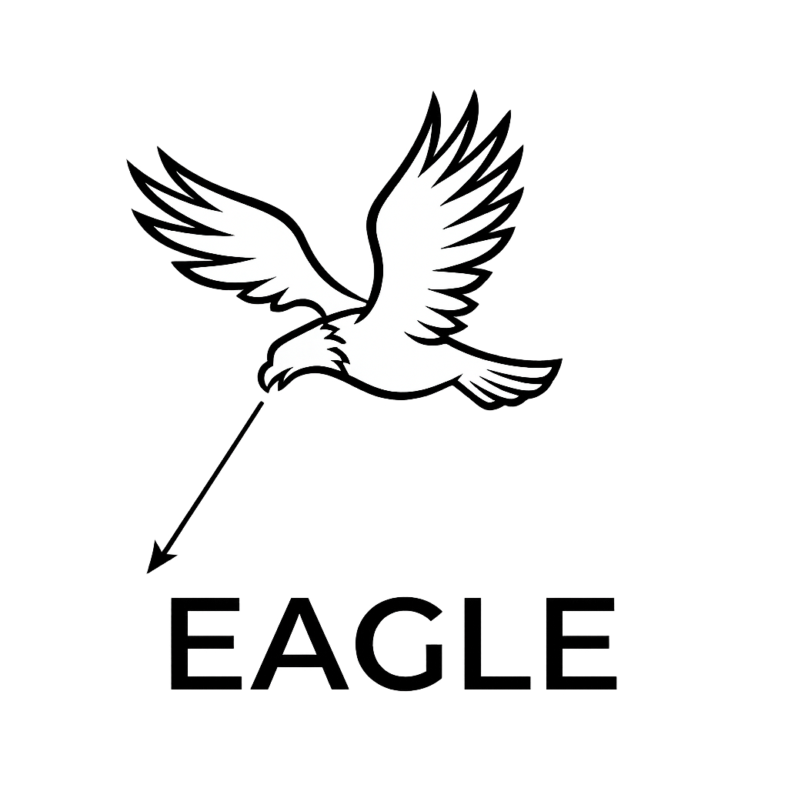
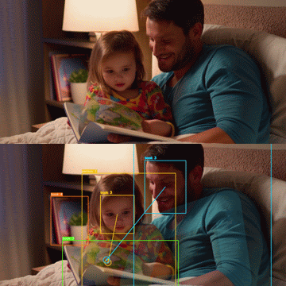
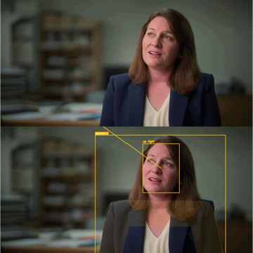
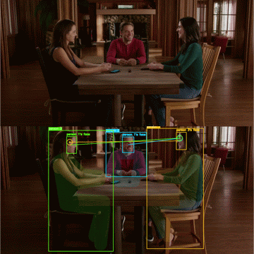
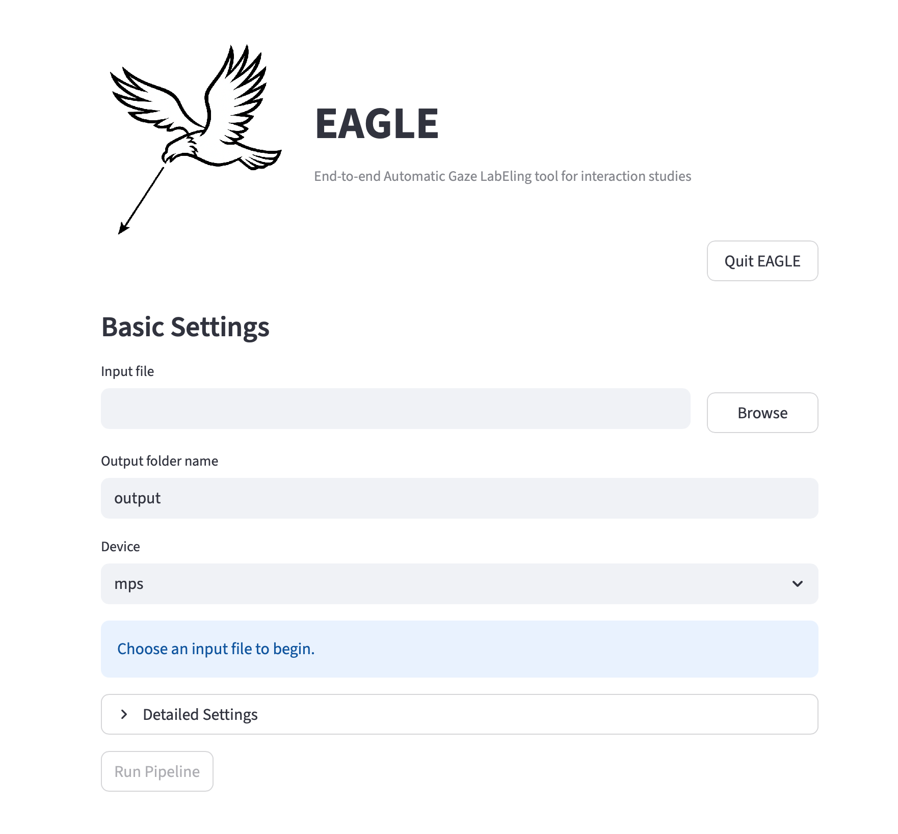

# EAGLE
<p align="center">
  <em><strong>E</strong>nd-to-end <strong>A</strong>utomatic <strong>G</strong>aze <strong>L</strong>ab<strong>E</strong>ling tool for interaction studies</em>
</p>

<p align="center">
  
</p>

## Idiomas

- [English](README.md)
- [日本語](README.ja.md)
- [简体中文](README.zh.md)
- [Español](README.es.md)

## Descripción general
EAGLE es una herramienta de apoyo para anotación de mirada, basada en Streamlit, para análisis de imágenes y videos. Combina:

- Seguimiento de personas con YOLO pose
- Seguimiento de objetos no humanos con YOLO detection
- Detección de rostros con SCRFD por defecto, con RetinaFace y MediaPipe también disponibles, o cajas de cabeza a partir de los puntos clave de pose
- Estimación de mapas de calor de mirada con PaGE por defecto, con GAZELLE y GAZELLE-DINOv3 también disponibles
- Estimación de dirección fuera de pantalla con GaT por defecto, con L2CS-Net y MobileOne también disponibles
- Exportación CSV y exportación de imágenes/videos anotados

EAGLE es una herramienta de asistencia para anotación, no una fuente garantizada de verdad terreno. Debes revisar y validar todos los resultados antes de usarlos en investigación, análisis, informes o toma de decisiones.

## Ejemplos de salida
<p align="center">
  
  
  
</p>

## Ejemplo de GUI
<p align="center">
  
</p>

## Qué hace el sistema actual
Para cada imagen o video de entrada, el pipeline actual puede:

- Detectar y seguir personas a partir de detecciones de pose
- Mantener opcionalmente todas las clases COCO o solo clases seleccionadas
- Detectar un rostro por cada persona seguida
- Estimar mapas de calor y puntos de mirada
- Inferir etiquetas de dirección fuera de pantalla como `left`, `up right`, `down` o `front` (orientación centrada en la persona)
- Generar segmentos de mirada estilo ELAN en `annotation.csv`
- Reutilizar las cachés de cada fase cuando los ajustes siguen coincidiendo

Para detecciones de personas, EAGLE también usa pose keypoints para asignar la mirada a partes del cuerpo como face, head, torso, arms o legs cuando es posible.

## Entradas compatibles
- Imágenes: `.jpg`, `.jpeg`, `.png`, `.bmp`, `.tif`, `.tiff`, `.webp`
- Videos: `.mp4`, `.mov`, `.avi`, `.mkv`, `.m4v`, `.wmv`, `.webm`

## Descarga
Los paquetes precompilados de la aplicación están disponibles en GitHub Releases:

- https://github.com/Taiga-Mori/EAGLE/releases

## Configuración
Crea un entorno virtual e instala las dependencias:

```bash
python -m venv venv
source venv/bin/activate
pip install -r requirements.txt
```

Versión recomendada de Python: `3.10`

En Google Colab (Python 3.12), instala en su lugar los requisitos con versiones fijadas para Colab y luego reinicia la sesión:

```bash
pip install -r requirements-colab.txt
```

## Iniciar la aplicación
Recomendado:

```bash
python app.py
```

Este lanzador inicia Streamlit por ti y abre la aplicación en un navegador. Si el puerto `8501` no está disponible, prueba automáticamente puertos cercanos.

También puedes ejecutar Streamlit directamente:

```bash
venv/bin/streamlit run app.py
```

### Uso en un servidor GPU remoto
La aplicación funciona en el navegador, así que puedes iniciarla en un servidor con GPU y usarla desde tu propio ordenador. En el servidor, iníciala de modo que solo acepte conexiones locales:

```bash
venv/bin/streamlit run app.py --server.address 127.0.0.1 --server.port 8501 --server.headless true
```

Después, en tu ordenador, reenvía el puerto por SSH y abre http://localhost:8501:

```bash
ssh -N -L 8501:localhost:8501 usuario@servidor-gpu
```

Los archivos de entrada son rutas en el servidor (escríbelas o usa el explorador de archivos) y las salidas también se escriben allí. La aplicación no tiene inicio de sesión propio, así que usa un túnel SSH en lugar de abrir el puerto a la red.

## Primera ejecución y descarga de modelos
En el primer uso, EAGLE puede descargar y guardar en caché:

- Pesos YOLO object según sea necesario: `yolo26n.pt`, `yolo26s.pt`, `yolo26m.pt`, `yolo26l.pt` o `yolo26x.pt`
- `yolo26x-pose.pt`
- Pesos preentrenados de RetinaFace
- Archivos torch.hub de GAZELLE si se selecciona GAZELLE o un modelo GAZELLE personalizado
- Pesos de SCRFD (`scrfd_10g_bnkps.onnx`) si se selecciona SCRFD
- Pesos de GAZELLE-DINOv3 (`gazelle_dinov3_vitb16.pt`) y el código del modelo DINOv3 si se selecciona GAZELLE-DINOv3
- Pesos y código del modelo PaGE desde Hugging Face (`Octopus1/page-vitb`)
- `L2CSNet_gaze360.pkl` si se selecciona L2CS-Net
- `mobileone_s0.pt` si se selecciona MobileOne
- Pesos de GaT (`gat_stwsge_gaze360_gf.ckpt`) y el código Swin3D de Omnivore
- ffmpeg, si no hay en el PATH un ffmpeg con libx264: una compilación estática para tu plataforma (compilaciones de BtbN para Linux y Windows, y de Martin Riedl para macOS), guardada en `~/.EAGLE/ffmpeg/`

Si falla la carga inicial, comprueba:

- Que la máquina esté en línea
- Que GitHub / los endpoints de alojamiento de modelos sean accesibles
- Que el usuario actual pueda escribir en `~/.EAGLE/`

## Flujo de trabajo de la aplicación
1. Inicia la app con `python app.py`.
2. Configura `Input file`:
   - macOS/Windows: haz clic en `Browse`.
   - Linux/Docker: usa `Container File Browser` o escribe una ruta montada.
3. Selecciona una imagen o video de entrada.
4. Confirma el tipo de medio detectado.
5. Edita `Output folder name` si hace falta.
6. Abre `Detailed Settings` si quieres.
7. Haz clic en `Run Pipeline`.
8. Revisa las rutas de salida mostradas al final.

Comportamiento del directorio de salida:

- Si el directorio de entrada permite escritura, el padre de salida es el mismo que el padre del archivo de entrada.
- Si el directorio de entrada es de solo lectura, común con montajes Docker `:ro`, la salida usa `/app/output/<input_stem>`.
- El nombre predeterminado de la carpeta de salida es el stem de la entrada.
- Ejemplo:
  - Entrada: `/data/session01/test.mp4`
  - Padre con escritura: `/data/session01/test`
  - Fallback para padre de solo lectura: `/app/output/test`

## Ajustes principales

### Basic Settings
- `Input file`
  - macOS/Windows: campo editable que también puede rellenarse con `Browse`.
  - Linux/Docker: campo editable, con entrada manual de ruta.
- `Output folder name`
  - Carpeta creada junto al archivo de entrada.
- `Device`
  - Usa `cuda:0`, `cuda:1`, ... cuando hay varias GPU NVIDIA disponibles; si no, `mps` o `cpu`.

### Inference
- `Person detection backend`
  - `yolo26x-pose`.
- `Object detection backend`
  - Selecciona el backend YOLO26 detection (`yolo26n`, `yolo26s`, `yolo26m`, `yolo26l` o `yolo26x`). Los pesos descargados se conservan en `~/.EAGLE/` para reutilizarlos.
- `Face detection backend`
  - `scrfd` (SCRFD) por defecto, `retinaface` para RetinaFace, `mediapipe` si quieres usar MediaPipe, o `yolo-pose` para omitir la detección de rostros y obtener las cajas de cabeza a partir de los puntos clave de pose de YOLO (nariz, ojos, orejas). `yolo-pose` es la opción más rápida y funcionó igual de bien que los rostros detectados en nuestra evaluación. `retinaface` y `mediapipe` buscan rostros en un recorte ampliado alrededor de la cabeza de cada persona, estimada a partir de la pose; así detectan rostros pequeños en planos amplios y son más rápidos que sobre el fotograma completo. `scrfd` trabaja sobre el fotograma completo.
- `Gaze detection backend`
  - `page_vitb` (PaGE, DINOv3 ViT-B) por defecto, `gazelle` (modelo preentrenado oficial de GAZELLE, DINOv2 ViT-L), `gazelle_dinov3_vitb16` (GAZELLE-DINOv3, DINOv3 ViT-B) o modelos GAZELLE ajustados colocados en `~/.EAGLE/custom/gaze/`.
- `Head pose detection backend`
  - Estima la dirección de la mirada de las personas que miran fuera del encuadre. `gat` por defecto: GaT (ST-WSGE, CVPR 2025) estima la mirada 3D a partir del recorte de la cabeza y, por tanto, también funciona cuando el rostro se ve de lado o de espaldas. `l2cs` estima la mirada a partir del recorte del rostro, y `mobileone` es el modelo anterior basado en MobileOne.
- `Person threshold`, `Object threshold`, `Face threshold`, `Gaze threshold`
  - Umbrales separados para seguimiento de personas con pose, seguimiento de objetos que no son personas, detección de rostros e interpretación gaze in/out.
- `Visualization mode`
  - `both`, `point` o `heatmap`
- `Heatmap alpha`
  - Intensidad de superposición para salidas de heatmap.
- `Gaze target radius (px)`
  - `0` significa asignación solo por punto. Valores mayores usan un área circular alrededor del punto de mirada.
- `Person part distance scale`
  - Controla cuán lejos puede estar la mirada de los keypoints de una persona y seguir contando como parte del cuerpo.
- `Person part keypoint min confidence`
  - Confianza mínima de pose keypoint usada para asignar partes del cuerpo. El valor predeterminado es `0.0`.
- `Reuse existing persons.csv/objects.csv/faces.csv/gaze.csv when available`
  - Reutiliza la caché de cada fase por separado cuando los metadatos siguen coincidiendo con la ejecución actual.
- `Track all object classes`
  - Al desactivarlo, puedes elegir explícitamente qué clases COCO conservar.

### Temporal Settings
- `Person smoothing window`
  - Ventana de suavizado para cajas de personas.
- `Merge duplicate and switched person tracks`, `Duplicate track IoU`, `ID switch max gap (seconds)`
  - Solo para vídeos, activado por defecto. Las pistas que enmarcan a la misma persona (IoU de al menos 0,6, o una caja dentro de la otra con la misma cabeza, en al menos el 80 % de sus fotogramas comunes) se fusionan en la más larga, y una pista que empieza a menos de 3 s del final de otra, en el mismo lugar y con un tamaño similar, se une como su continuación (cambio de ID). Los huecos se interpolan. Las pistas sin procesar se conservan en `persons_raw.csv`, y al cambiar estos ajustes solo se vuelve a ejecutar el posprocesado.
- `Min person duration for gaze estimation (fraction of video)`
  - Solo para vídeos, 0,5 por defecto. Tras el posprocesado, las pistas de personas visibles en menos de esta fracción del vídeo (transeúntes, fragmentos sobrantes) se eliminan de `persons.csv`: no se estima su mirada ni son objetivos de mirada. Usa 0 para conservar a todos, por ejemplo si hay personas que entran o salen durante el vídeo.
- `Object smoothing window`
  - Ventana de suavizado para cajas de objetos seguidos.
- `Face smoothing window`
  - Ventana de suavizado para cajas de rostro interpoladas.
- `Gaze point smoothing (seconds, 0=disabled)`
  - Solo para vídeos, 0,1 por defecto. Antes de decidir los objetivos de mirada, el punto de mirada de cada persona se suaviza en el tiempo con un filtro gaussiano centrado cuya desviación estándar es esta duración. Al ser centrado, elimina saltos breves sin retrasar los cambios de mirada. En nuestra evaluación elevó la F1 macro en unos 0,02 y el κ de Cohen en 0,01-0,02, y redujo entre un tercio y la mitad los cambios de etiqueta, cerca de la frecuencia de la anotación humana; los filtros causales (suavizado exponencial, One Euro) y el suavizado de etiquetas no ayudaron. Los vídeos renderizados, `gaze.csv` y `annotation.csv` usan los puntos suavizados. Al cambiar este valor se reutilizan los mapas de calor en caché, sin volver a ejecutar el modelo de mirada.
- `Person frame FPS`, `Object frame FPS`, `Face frame FPS`, `Gaze frame FPS`, `Head pose frame FPS`
  - Solo videos. Cada etapa se ejecuta con el target FPS seleccionado y escribe su propia salida intermedia. Todas las etapas usan 10 FPS por defecto (o el FPS del vídeo si es menor), lo que dio la misma concordancia que procesar todos los fotogramas en nuestra evaluación.

Importante:

- Los FPS de etapas posteriores pueden cambiarse sin invalidar cachés de etapas anteriores cuando sus propios ajustes no cambian. Tracks, faces, gaze y head pose se interpolan o suavizan después de ejecutar cada etapa.
- Internamente, los target FPS se convierten a frame strides a partir del FPS de origen.

### BoT-SORT
La UI expone estos ajustes de tracker desde [`config/botsort.yaml`](config/botsort.yaml):

- `track_high_thresh`
- `track_low_thresh`
- `new_track_thresh`
- `track_buffer`
- `match_thresh`
- `Enable ReID`
- `proximity_thresh`
- `appearance_thresh`

## Evaluación comparativa
Comparamos configuraciones en 12 sesiones del [Chiba Three-party Conversation Corpus](https://research.nii.ac.jp/src/en/Chiba3Party.html) (tres participantes sentados, una cámara gran angular, 720x480, 9,4 minutos por sesión) frente a anotaciones humanas de la mirada. La etiqueta de cada participante en cada fotograma es el otro participante al que mira (mirada a su rostro) o *none*; se excluyen los fotogramas que los anotadores marcaron como desplazamientos de la mirada. Los tiempos son medianas por sesión en una NVIDIA GeForce RTX 3090 para todo el proceso, incluido el seguimiento de personas (3,4 minutos), sin renderizar vídeos. Las cajas de cabeza `YOLO pose` se obtienen de los puntos clave de pose (`yolo-pose`); las demás, de un detector de rostros.

| Modelo de mirada | Cajas de cabeza | FPS | Suavizado del punto | κ de Cohen | F1 macro | Tiempo (min) |
|---|---|---|---|---|---|---|
| PaGE | SCRFD | 10 (por defecto) | sí | 0.512 | 0.635 | 9.1 |
| PaGE | YOLO pose | 1 | sí | 0.463 | 0.594 | 5.3 |
| PaGE | YOLO pose | 10 | sí | **0.522** | 0.642 | 8.5 |
| PaGE | YOLO pose | 15 | sí | **0.522** | **0.643** | 9.9 |
| PaGE | YOLO pose | 15 | no | 0.504 | 0.617 | 9.9 |
| PaGE | SCRFD | 15 | no | 0.499 | 0.613 | 10.9 |
| PaGE | RetinaFace | 15 | no | 0.497 | 0.610 | 15.6 |
| PaGE | MediaPipe | 15 | no | 0.494 | 0.606 | 18.1 |
| GAZELLE | YOLO pose | 15 | no | 0.380 | 0.511 | 8.3 |
| GAZELLE-DINOv3 | YOLO pose | 15 | no | 0.364 | 0.498 | 7.7 |

Todos los modelos de mirada y frecuencias con SCRFD (el detector de rostros por defecto), sin suavizado del punto de mirada; los tiempos incluyen el seguimiento de personas:

| Modelo de mirada | FPS | κ de Cohen | F1 macro | Tiempo (min) |
|---|---|---|---|---|
| GAZELLE | 1 | 0.360 | 0.503 | 5.3 |
| GAZELLE | 10 | 0.381 | 0.517 | 8.1 |
| GAZELLE | 15 | 0.381 | 0.517 | 9.3 |
| GAZELLE | 29.97 | 0.381 | 0.517 | 13.4 |
| GAZELLE-DINOv3 | 1 | 0.348 | 0.491 | 5.2 |
| GAZELLE-DINOv3 | 10 | 0.368 | 0.504 | 7.6 |
| GAZELLE-DINOv3 | 15 | 0.368 | 0.504 | 8.5 |
| GAZELLE-DINOv3 | 29.97 | 0.368 | 0.503 | 12.0 |
| PaGE | 1 | 0.453 | 0.582 | 5.4 |
| PaGE | 10 | **0.499** | **0.613** | 9.1 |
| PaGE | 15 | **0.499** | **0.613** | 10.8 |
| PaGE | 29.97 | 0.498 | 0.612 | 16.3 |

- El modelo de mirada es lo más importante: PaGE supera a GAZELLE y GAZELLE-DINOv3 en 0,12-0,14 de κ en las 12 sesiones.
- Las cajas de cabeza derivadas de los puntos clave de pose (`yolo-pose`) funcionan tan bien como los rostros detectados (las cuatro opciones quedan a menos de 0,011 de κ) y no necesitan otro modelo. Los detectores de rostros solo añaden tiempo; RetinaFace y MediaPipe son los más lentos.
- 10 FPS da la misma concordancia que 15 FPS y que procesar todos los fotogramas, y es un 15 % más rápido; 1 FPS conserva alrededor del 90 %.
- El suavizado del punto de mirada (0,1 s por defecto) añade unos 0,02 de F1 macro y 0,01-0,02 de κ, sobre todo porque los intervalos cortos de *none* dejan de fragmentarse, y con la configuración por defecto reduce los cambios de etiqueta de 56 a 36 por minuto, cerca de los 35 de los anotadores humanos.
- Renderizar vídeos añade unos 1,8 minutos por sesión con los puntos de mirada (`point`) y 5,5 minutos con los mapas de calor por persona (`both`).
- La concordancia es mucho mayor para la persona de frente a la cámara que para las vistas de lado. Con la configuración por defecto:

| Participante | κ de Cohen | F1 macro |
|---|---|---|
| A (izquierda, de lado) | 0.388 | 0.546 |
| B (centro, de frente a la cámara) | 0.734 | 0.811 |
| C (derecha, de lado) | 0.413 | 0.547 |

  Cuando A o C no miran a ninguno de los otros, cerca de la mitad de esos fotogramas se etiquetan como mirando a B, cuya cabeza queda en su línea de mirada en la imagen; EAGLE etiqueta *none* en el 16 % (A) y el 9 % (C) de los fotogramas, frente al 40 % y el 35 % de la anotación humana.

## Consejos de velocidad
- Usa `cuda:*` en GPU NVIDIA, o `mps` en Apple Silicon cuando esté disponible.
- Reduce los FPS de cada etapa para disminuir trabajo de detección repetido, especialmente en etapas distintas de gaze.
- `yolo-pose` omite por completo la detección de rostros, y `scrfd` es el detector de rostros más rápido.
- El modelo de mirada procesa varios fotogramas a la vez, en float16 en CUDA (`gaze_half_precision=True` por defecto); en CUDA es unas 3 veces más rápido que fotograma a fotograma en float32 y con los mismos resultados. En Apple MPS se mantiene en float32: en un M3, float16 desplazó el pico del mapa de calor de 64x64 hasta 50 px (GAZELLE-DINOv3) y no fue más rápido.
- En Apple MPS, las capas de atención usan multiplicaciones de matrices simples en lugar del kernel SDPA de PyTorch, lo que hizo los modelos de mirada un 25-30 % más rápidos en un M3 con los mismos resultados.
- En Apple Silicon (`mps`), YOLO, RetinaFace y PaGE se ejecutan con Core ML (YOLO y RetinaFace en el Neural Engine, PaGE en la GPU). En un MacBook Air M3, un clip de 20 segundos con 3 personas a 15 FPS pasó de 6:23 a 1:50 con los mismos tracks y puntos de mirada (IoU de las cajas de persona 0,996, picos del mapa de calor de PaGE a 2 celdas o menos de PyTorch). Los modelos se convierten una vez en el primer uso (unos minutos) y se guardan en `~/.EAGLE/coreml`. Define `EAGLE_DISABLE_COREML=1` para usar solo PyTorch; YOLO y RetinaFace se ejecutan entonces en float16 en MPS.
- El seguimiento de personas y objetos ejecuta YOLO sobre 16 fotogramas a la vez, en float16 en CUDA; en nuestra evaluación redujo a la mitad el tiempo de seguimiento con los mismos resultados.
- Si solo necesitas las salidas CSV y ELAN, desactiva `Render visualization videos` (`render_video=False`) para omitir el dibujo y la codificación de los vídeos anotados.

## Archivos de salida
Las salidas actuales pueden incluir:

- `persons.csv`
  - Resultados suavizados de seguimiento de personas tras fusionar pistas duplicadas y con cambio de ID (los usan las etapas posteriores; las fusiones se registran en `.persons_meta.json`)
- `persons_raw.csv`
  - Resultados suavizados de seguimiento de personas antes de ese posprocesado
- `.persons_meta.json`
  - Metadatos usados para validar la reutilización de person cache
- `objects.csv`
  - Resultados suavizados de seguimiento de objetos que no son personas
- `.objects_meta.json`
  - Metadatos usados para validar la reutilización de object cache
- `faces.csv`
  - Cajas de detección de rostro asignadas a tracks de persona
- `.faces_meta.json`
  - Metadatos usados para validar la reutilización de face cache
- `gaze.csv`
  - Puntos de mirada (interpolados y suavizados, ver `Gaze point smoothing`), probabilidad in/out y campos de dirección fuera de pantalla
- `gaze_heatmaps.npz`
  - Mapas de calor de mirada de los fotogramas muestreados en caché (float16; los fotogramas intermedios se reinterpolan al reutilizar la caché)
- `.gaze_meta.json`
  - Metadatos usados para validar la reutilización de gaze cache
- `annotation.csv`
  - Segmentos de mirada estilo ELAN o etiquetas para una sola imagen
- `all_points.jpg`
  - Visualización de puntos para entrada de imagen
- `all_points.mp4`
  - Visualización de puntos para entrada de video
- `person_<track_id>_heatmap.jpg`
  - Heatmap por persona para entrada de imagen
- `person_<track_id>_heatmap.mp4`
  - Heatmap por persona para entrada de video

Las carpetas temporales como `temp/` y `heatmaps/` se eliminan después de exportar.

## Contenido de CSV
Columnas de `persons.csv`:

- `frame_idx`
- `cls`
- `track_id`
- `object_detected`
- `source`
- `conf`
- `x1`, `y1`, `x2`, `y2`
- `pose_keypoints`
- `label`

Columnas de `objects.csv`:

- `frame_idx`
- `cls`
- `track_id`
- `object_detected`
- `source`
- `conf`
- `x1`, `y1`, `x2`, `y2`
- `pose_keypoints`
- `label`

Columnas de `faces.csv`:

- `frame_idx`
- `track_id`
- `face_detected`
- `face_conf`
- `face_x1`, `face_y1`, `face_x2`, `face_y2`

Columnas de `gaze.csv`:

- `frame_idx`
- `track_id`
- `gaze_detected`
- `inout`
- `x_gaze`, `y_gaze`
- `offscreen_direction`
- `offscreen_yaw`
- `offscreen_pitch`

Columnas de `annotation.csv`:

- `tier`
- `start_time`
- `end_time`
- `gaze`

## Puntos de entrada para desarrollo
- [`app.py`](app.py)
  - UI de Streamlit y lanzador
- [`main.py`](main.py)
  - Entrada mínima para smoke test local
- [`eagle/pipeline.py`](eagle/pipeline.py)
  - Fachada principal de la API Python

Uso mínimo en código:

```python
from eagle import EAGLE

eagle = EAGLE()
eagle.preprocess(
    input_path="input.mp4",
    output_dir="output_dir",
    person_target_fps=15,
    object_target_fps=15,
    face_target_fps=15,
    gaze_target_fps=15,
    head_pose_target_fps=15,
    person_det_thresh=0.5,
    object_det_thresh=0.5,
    face_det_thresh=0.5,
    gaze_det_thresh=0.5,
    person_detection_backend="yolo26x-pose",
    object_detection_backend="yolo26x",
    face_detection_backend="retinaface",
    gaze_detection_backend="page_vitb",
    head_pose_detection_backend="gat",
    device="cpu",
    visualization_mode="both",
    person_part_min_conf=0.0,
    person_max_switch_gap=15,
)
results = eagle.run_all()
```

## Aviso legal
- Usa este software bajo tu propio riesgo.
- EAGLE no garantiza la corrección de detecciones, estimaciones de mirada, asignaciones de objetivo ni anotaciones exportadas.
- La responsabilidad final de revisión y corrección permanece con el usuario.

## Licencia
Este proyecto está licenciado bajo `AGPL-3.0-or-later`. Consulta [LICENSE](LICENSE) para el texto de licencia del repositorio.

Los modelos descargados en tiempo de ejecución se distribuyen bajo sus propias licencias:

- Código y pesos de GAZELLE, GAZELLE-DINOv3 y PaGE: MIT License.
- Los pesos de GAZELLE-DINOv3 y PaGE incluyen o derivan de DINOv3, por lo que también se aplica la [DINOv3 License](https://github.com/facebookresearch/dinov3/blob/main/LICENSE.md) (por ejemplo, incluir la licencia al redistribuir, mencionar DINOv3 en publicaciones y no usarlo con fines militares).
- Los pesos de SCRFD provienen de InsightFace, cuyos modelos preentrenados se ofrecen solo para investigación no comercial.
- Los pesos de GaT y el código Swin3D de Omnivore están bajo CC BY-NC 4.0 (solo uso no comercial).

## Agradecimientos
- Ultralytics YOLO
  - https://docs.ultralytics.com/
- BoT-SORT
  - https://github.com/NirAharon/BoT-SORT
- MediaPipe
  - https://developers.google.com/mediapipe
- RetinaFace
  - https://github.com/serengil/retinaface
- GAZELLE
  - https://github.com/fkryan/gazelle
- GAZELLE-DINOv3
  - https://github.com/PINTO0309/gazelle-dinov3
- PaGE
  - https://github.com/OctopusWen/PaGE
- DINOv3
  - https://github.com/facebookresearch/dinov3
- SCRFD (InsightFace)
  - https://github.com/deepinsight/insightface
- GaT / ST-WSGE (3D gaze estimation)
  - https://github.com/idiap/gaze3d
- L2CS-Net
  - https://github.com/Ahmednull/L2CS-Net
- MobileOne gaze-estimation weights
  - https://github.com/yakhyo/gaze-estimation
