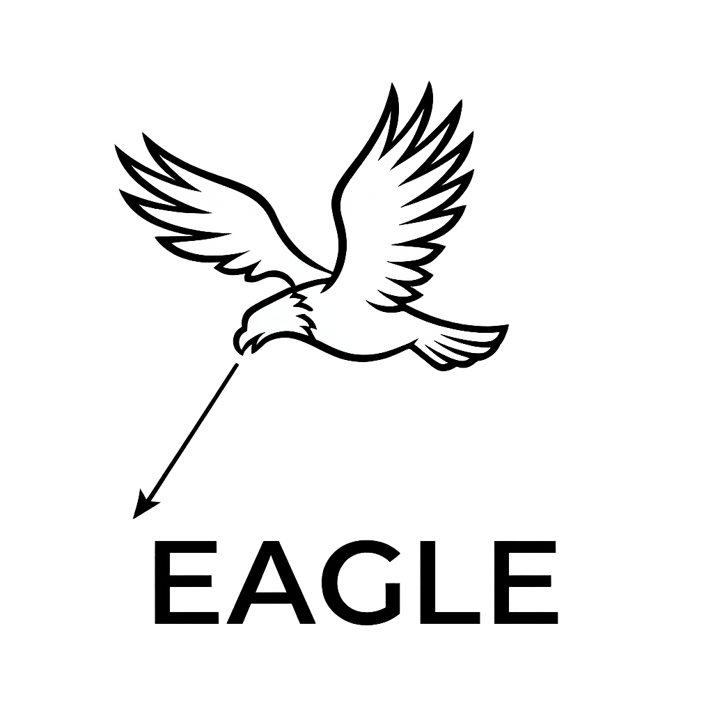
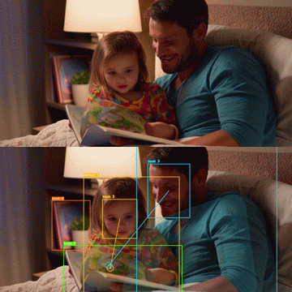
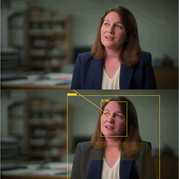
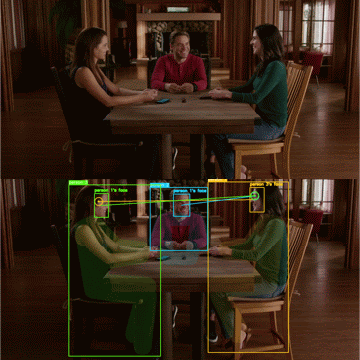
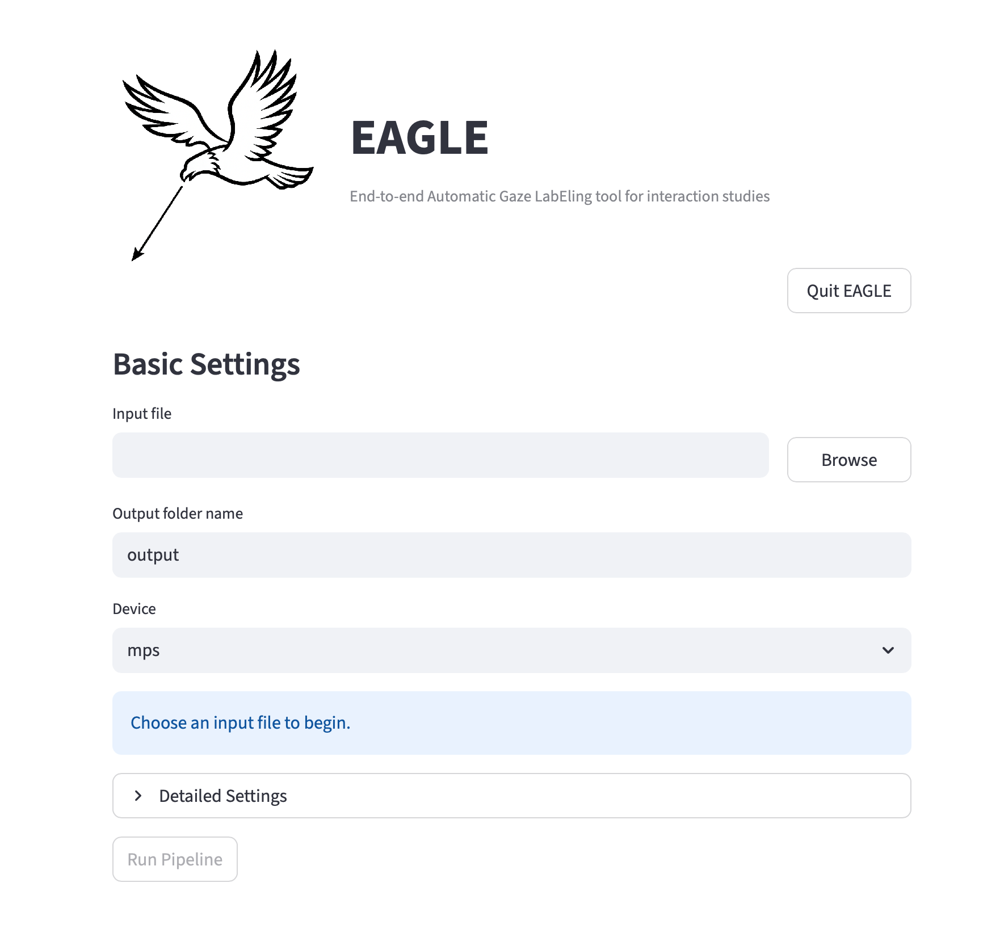

# EAGLE
<p align="center">
  <em><strong>E</strong>nd-to-end <strong>A</strong>utomatic <strong>G</strong>aze <strong>L</strong>ab<strong>E</strong>ling tool for interaction studies</em>
</p>

<p align="center">
  
</p>

## Idiomas

- [English](README.md)
- [日本語](README.ja.md)
- [简体中文](README.zh.md)
- [Español](README.es.md)

## Descripción general
EAGLE es una herramienta de apoyo para anotación de mirada, basada en Streamlit, para análisis de imágenes y videos. Combina:

- Seguimiento de personas con YOLO pose
- Seguimiento de objetos no humanos con YOLO detection
- Detección de rostros con RetinaFace por defecto, con SCRFD y MediaPipe también disponibles
- Estimación de mapas de calor de mirada con GAZELLE, GAZELLE-DINOv3 o PaGE
- Estimación de dirección fuera de pantalla con L2CS-Net por defecto, con MobileOne también disponible
- Exportación CSV y exportación de imágenes/videos anotados

EAGLE es una herramienta de asistencia para anotación, no una fuente garantizada de verdad terreno. Debes revisar y validar todos los resultados antes de usarlos en investigación, análisis, informes o toma de decisiones.

## Ejemplos de salida
<p align="center">
  
  
  
</p>

## Ejemplo de GUI
<p align="center">
  
</p>

## Qué hace el sistema actual
Para cada imagen o video de entrada, el pipeline actual puede:

- Detectar y seguir personas a partir de detecciones de pose
- Mantener opcionalmente todas las clases COCO o solo clases seleccionadas
- Detectar un rostro por cada persona seguida
- Estimar mapas de calor y puntos de mirada
- Inferir etiquetas de dirección fuera de pantalla como `left`, `up right`, `down` o `front` (orientación centrada en la persona)
- Generar segmentos de mirada estilo ELAN en `annotation.csv`
- Reutilizar las cachés de cada fase cuando los ajustes siguen coincidiendo

Para detecciones de personas, EAGLE también usa pose keypoints para asignar la mirada a partes del cuerpo como face, head, torso, arms o legs cuando es posible.

## Entradas compatibles
- Imágenes: `.jpg`, `.jpeg`, `.png`, `.bmp`, `.tif`, `.tiff`, `.webp`
- Videos: `.mp4`, `.mov`, `.avi`, `.mkv`, `.m4v`, `.wmv`, `.webm`

## Descarga
Los paquetes precompilados de la aplicación están disponibles en GitHub Releases:

- https://github.com/Taiga-Mori/EAGLE/releases

## Configuración
Crea un entorno virtual e instala las dependencias:

```bash
python -m venv venv
source venv/bin/activate
pip install -r requirements.txt
```

Versión recomendada de Python: `3.10`

En Google Colab (Python 3.12), instala en su lugar los requisitos con versiones fijadas para Colab y luego reinicia la sesión:

```bash
pip install -r requirements-colab.txt
```

## Iniciar la aplicación
Recomendado:

```bash
python app.py
```

Este lanzador inicia Streamlit por ti y abre la aplicación en un navegador. Si el puerto `8501` no está disponible, prueba automáticamente puertos cercanos.

También puedes ejecutar Streamlit directamente:

```bash
venv/bin/streamlit run app.py
```

## Primera ejecución y descarga de modelos
En el primer uso, EAGLE puede descargar y guardar en caché:

- Pesos YOLO object según sea necesario: `yolo26n.pt`, `yolo26s.pt`, `yolo26m.pt`, `yolo26l.pt` o `yolo26x.pt`
- `yolo26x-pose.pt`
- Pesos preentrenados de RetinaFace
- Archivos torch.hub de GAZELLE
- Pesos de SCRFD (`scrfd_10g_bnkps.onnx`) si se selecciona SCRFD
- Pesos de GAZELLE-DINOv3 (`gazelle_dinov3_vitb16.pt`) y el código del modelo DINOv3 si se selecciona GAZELLE-DINOv3
- Pesos y código del modelo PaGE desde Hugging Face (`Octopus1/page-vitb`) si se selecciona PaGE
- `L2CSNet_gaze360.pkl`
- `mobileone_s0.pt`
- Pesos de GaT (`gat_stwsge_gaze360_gf.ckpt`) y el código Swin3D de Omnivore si se selecciona GaT

Si falla la carga inicial, comprueba:

- Que la máquina esté en línea
- Que GitHub / los endpoints de alojamiento de modelos sean accesibles
- Que el usuario actual pueda escribir en `~/.EAGLE/`

## Flujo de trabajo de la aplicación
1. Inicia la app con `python app.py`.
2. Configura `Input file`:
   - macOS/Windows: haz clic en `Browse`.
   - Linux/Docker: usa `Container File Browser` o escribe una ruta montada.
3. Selecciona una imagen o video de entrada.
4. Confirma el tipo de medio detectado.
5. Edita `Output folder name` si hace falta.
6. Abre `Detailed Settings` si quieres.
7. Haz clic en `Run Pipeline`.
8. Revisa las rutas de salida mostradas al final.

Comportamiento del directorio de salida:

- Si el directorio de entrada permite escritura, el padre de salida es el mismo que el padre del archivo de entrada.
- Si el directorio de entrada es de solo lectura, común con montajes Docker `:ro`, la salida usa `/app/output/<input_stem>`.
- El nombre predeterminado de la carpeta de salida es el stem de la entrada.
- Ejemplo:
  - Entrada: `/data/session01/test.mp4`
  - Padre con escritura: `/data/session01/test`
  - Fallback para padre de solo lectura: `/app/output/test`

## Ajustes principales

### Basic Settings
- `Input file`
  - macOS/Windows: campo editable que también puede rellenarse con `Browse`.
  - Linux/Docker: campo editable, con entrada manual de ruta.
- `Output folder name`
  - Carpeta creada junto al archivo de entrada.
- `Device`
  - Usa `cuda:0`, `cuda:1`, ... cuando hay varias GPU NVIDIA disponibles; si no, `mps` o `cpu`.

### Inference
- `Person detection backend`
  - `yolo26x-pose`.
- `Object detection backend`
  - Selecciona el backend YOLO26 detection (`yolo26n`, `yolo26s`, `yolo26m`, `yolo26l` o `yolo26x`). Los pesos descargados se conservan en `~/.EAGLE/` para reutilizarlos.
- `Face detection backend`
  - `retinaface` por defecto, `scrfd` para SCRFD, `mediapipe` si quieres usar MediaPipe, o `yolo-pose` para omitir la detección de rostros y obtener las cajas de cabeza a partir de los puntos clave de pose de YOLO (nariz, ojos, orejas). `yolo-pose` es la opción más rápida y funcionó igual de bien que los rostros detectados en nuestra evaluación.
- `Gaze detection backend`
  - `gazelle` (modelo preentrenado oficial de GAZELLE, DINOv2 ViT-L), `gazelle_dinov3_vitb16` (GAZELLE-DINOv3, DINOv3 ViT-B), `page_vitb` (PaGE, DINOv3 ViT-B) o modelos GAZELLE ajustados colocados en `~/.EAGLE/custom/gaze/`.
- `Head pose detection backend`
  - Estima la dirección de la mirada de las personas que miran fuera del encuadre. `l2cs` por defecto (mirada a partir del recorte del rostro), `mobileone` para el modelo anterior basado en MobileOne, o `gat` para GaT (ST-WSGE, CVPR 2025), que estima la mirada 3D a partir del recorte de la cabeza y, por tanto, también funciona cuando el rostro se ve de lado o de espaldas.
- `Person threshold`, `Object threshold`, `Face threshold`, `Gaze threshold`
  - Umbrales separados para seguimiento de personas con pose, seguimiento de objetos que no son personas, detección de rostros e interpretación gaze in/out.
- `Visualization mode`
  - `both`, `point` o `heatmap`
- `Heatmap alpha`
  - Intensidad de superposición para salidas de heatmap.
- `Gaze target radius (px)`
  - `0` significa asignación solo por punto. Valores mayores usan un área circular alrededor del punto de mirada.
- `Person part distance scale`
  - Controla cuán lejos puede estar la mirada de los keypoints de una persona y seguir contando como parte del cuerpo.
- `Person part keypoint min confidence`
  - Confianza mínima de pose keypoint usada para asignar partes del cuerpo. El valor predeterminado es `0.0`.
- `Reuse existing persons.csv/objects.csv/faces.csv/gaze.csv when available`
  - Reutiliza la caché de cada fase por separado cuando los metadatos siguen coincidiendo con la ejecución actual.
- `Track all object classes`
  - Al desactivarlo, puedes elegir explícitamente qué clases COCO conservar.

### Temporal Settings
- `Person smoothing window`
  - Ventana de suavizado para cajas de personas.
- `Merge duplicate and switched person tracks`, `Duplicate track IoU`, `ID switch max gap (seconds)`
  - Solo para vídeos, activado por defecto. Las pistas que enmarcan a la misma persona (IoU de al menos 0,6, o una caja dentro de la otra con la misma cabeza, en al menos el 80 % de sus fotogramas comunes) se fusionan en la más larga, y una pista que empieza a menos de 3 s del final de otra, en el mismo lugar y con un tamaño similar, se une como su continuación (cambio de ID). Los huecos se interpolan. Las pistas sin procesar se conservan en `persons_raw.csv`, y al cambiar estos ajustes solo se vuelve a ejecutar el posprocesado.
- `Object smoothing window`
  - Ventana de suavizado para cajas de objetos seguidos.
- `Face smoothing window`
  - Ventana de suavizado para cajas de rostro interpoladas.
- `Gaze label smoothing (seconds, 0=disabled)`
  - Solo para vídeos. El objetivo de mirada de cada fotograma en `annotation.csv` se sustituye por el objetivo más frecuente en una ventana centrada de esta duración (0,3 s por defecto), lo que elimina parpadeos breves. Los puntos de mirada y los mapas de calor no se suavizan.
- `Person frame FPS`, `Object frame FPS`, `Face frame FPS`, `Gaze frame FPS`, `Head pose frame FPS`
  - Solo videos. Cada etapa se ejecuta con el target FPS seleccionado y escribe su propia salida intermedia.

Importante:

- Los FPS de etapas posteriores pueden cambiarse sin invalidar cachés de etapas anteriores cuando sus propios ajustes no cambian. Tracks, faces, gaze y head pose se interpolan o suavizan después de ejecutar cada etapa.
- Internamente, los target FPS se convierten a frame strides a partir del FPS de origen.

### BoT-SORT
La UI expone estos ajustes de tracker desde [`config/botsort.yaml`](config/botsort.yaml):

- `track_high_thresh`
- `track_low_thresh`
- `new_track_thresh`
- `track_buffer`
- `match_thresh`
- `Enable ReID`
- `proximity_thresh`
- `appearance_thresh`

## Evaluación comparativa
Comparamos configuraciones en 12 sesiones del [Chiba Three-party Conversation Corpus](https://research.nii.ac.jp/src/en/Chiba3Party.html) (tres participantes sentados, una cámara gran angular, 720x480, 9,4 minutos por sesión) frente a anotaciones humanas de la mirada. La etiqueta de cada participante en cada fotograma es el otro participante al que mira (mirada a su rostro) o *none*. Los tiempos son medianas por sesión en una NVIDIA GeForce RTX 3090 e incluyen detección de rostros, estimación de la mirada y exportación; el seguimiento de personas (común a todas las configuraciones) tardó otros 7,0 minutos.

| Modelo de mirada | Detector de rostros | FPS | κ de Cohen | F1 macro | Tiempo (min) |
|---|---|---|---|---|---|
| PaGE | SCRFD | 1 | 0.435 | 0.569 | 9.9 |
| PaGE | SCRFD | 15 | 0.471 | 0.601 | 23.2 |
| PaGE | MediaPipe | 15 | **0.483** | **0.610** | 25.2 |
| PaGE | RetinaFace | 29.97 | 0.472 | 0.602 | 65.4 |
| GAZELLE | SCRFD | 15 | 0.364 | 0.504 | 22.0 |
| GAZELLE-DINOv3 | SCRFD | 15 | 0.353 | 0.500 | 17.3 |

- El modelo de mirada es lo más importante: PaGE supera a GAZELLE y GAZELLE-DINOv3 en unos 0,1 de κ en las 12 sesiones.
- El detector de rostros apenas afecta a la concordancia (≤0,012 de κ), pero sí mucho a la velocidad: SCRFD es el más rápido y RetinaFace el más lento. MediaPipe casi no detecta rostros en este vídeo gran angular (el 99,6 % de las cajas de cabeza se obtienen de los puntos clave de pose), por lo que sus filas muestran en la práctica que las cajas de cabeza derivadas de la pose funcionan tan bien como los rostros detectados.
- 15 FPS da la misma concordancia que procesar todos los fotogramas; 1 FPS conserva más del 90 % a velocidad casi en tiempo real.
- La concordancia es mucho mayor para la persona de frente a la cámara (κ 0,68) que para las vistas de lado (κ ≈ 0,38).

## Consejos de velocidad
- Usa `cuda:*` en GPU NVIDIA, o `mps` en Apple Silicon cuando esté disponible.
- Reduce los FPS de cada etapa para disminuir trabajo de detección repetido, especialmente en etapas distintas de gaze.
- Si los rostros son mayoritariamente frontales, prueba `mediapipe` como face detection backend.

## Archivos de salida
Las salidas actuales pueden incluir:

- `persons.csv`
  - Resultados suavizados de seguimiento de personas tras fusionar pistas duplicadas y con cambio de ID (los usan las etapas posteriores; las fusiones se registran en `.persons_meta.json`)
- `persons_raw.csv`
  - Resultados suavizados de seguimiento de personas antes de ese posprocesado
- `.persons_meta.json`
  - Metadatos usados para validar la reutilización de person cache
- `objects.csv`
  - Resultados suavizados de seguimiento de objetos que no son personas
- `.objects_meta.json`
  - Metadatos usados para validar la reutilización de object cache
- `faces.csv`
  - Cajas de detección de rostro asignadas a tracks de persona
- `.faces_meta.json`
  - Metadatos usados para validar la reutilización de face cache
- `gaze.csv`
  - Puntos de mirada, probabilidad in/out y campos de dirección fuera de pantalla (interpolados, sin suavizar)
- `gaze_heatmaps.npz`
  - Mapas de calor de mirada de los fotogramas muestreados en caché (float16; los fotogramas intermedios se reinterpolan al reutilizar la caché)
- `.gaze_meta.json`
  - Metadatos usados para validar la reutilización de gaze cache
- `annotation.csv`
  - Segmentos de mirada estilo ELAN o etiquetas para una sola imagen
- `all_points.jpg`
  - Visualización de puntos para entrada de imagen
- `all_points.mp4`
  - Visualización de puntos para entrada de video
- `person_<track_id>_heatmap.jpg`
  - Heatmap por persona para entrada de imagen
- `person_<track_id>_heatmap.mp4`
  - Heatmap por persona para entrada de video

Las carpetas temporales como `temp/` y `heatmaps/` se eliminan después de exportar.

## Contenido de CSV
Columnas de `persons.csv`:

- `frame_idx`
- `cls`
- `track_id`
- `object_detected`
- `source`
- `conf`
- `x1`, `y1`, `x2`, `y2`
- `pose_keypoints`
- `label`

Columnas de `objects.csv`:

- `frame_idx`
- `cls`
- `track_id`
- `object_detected`
- `source`
- `conf`
- `x1`, `y1`, `x2`, `y2`
- `pose_keypoints`
- `label`

Columnas de `faces.csv`:

- `frame_idx`
- `track_id`
- `face_detected`
- `face_conf`
- `face_x1`, `face_y1`, `face_x2`, `face_y2`

Columnas de `gaze.csv`:

- `frame_idx`
- `track_id`
- `gaze_detected`
- `inout`
- `x_gaze`, `y_gaze`
- `offscreen_direction`
- `offscreen_yaw`
- `offscreen_pitch`

Columnas de `annotation.csv`:

- `tier`
- `start_time`
- `end_time`
- `gaze`

## Puntos de entrada para desarrollo
- [`app.py`](app.py)
  - UI de Streamlit y lanzador
- [`main.py`](main.py)
  - Entrada mínima para smoke test local
- [`eagle/pipeline.py`](eagle/pipeline.py)
  - Fachada principal de la API Python

Uso mínimo en código:

```python
from eagle import EAGLE

eagle = EAGLE()
eagle.preprocess(
    input_path="input.mp4",
    output_dir="output_dir",
    person_target_fps=15,
    object_target_fps=15,
    face_target_fps=15,
    gaze_target_fps=15,
    head_pose_target_fps=15,
    person_det_thresh=0.5,
    object_det_thresh=0.5,
    face_det_thresh=0.5,
    gaze_det_thresh=0.5,
    person_detection_backend="yolo26x-pose",
    object_detection_backend="yolo26x",
    face_detection_backend="retinaface",
    gaze_detection_backend="gazelle",
    head_pose_detection_backend="l2cs",
    device="cpu",
    visualization_mode="both",
    person_part_min_conf=0.0,
    person_max_switch_gap=15,
)
results = eagle.run_all()
```

## Aviso legal
- Usa este software bajo tu propio riesgo.
- EAGLE no garantiza la corrección de detecciones, estimaciones de mirada, asignaciones de objetivo ni anotaciones exportadas.
- La responsabilidad final de revisión y corrección permanece con el usuario.

## Licencia
Este proyecto está licenciado bajo `AGPL-3.0-or-later`. Consulta [LICENSE](LICENSE) para el texto de licencia del repositorio.

Los modelos descargados en tiempo de ejecución se distribuyen bajo sus propias licencias:

- Código y pesos de GAZELLE, GAZELLE-DINOv3 y PaGE: MIT License.
- Los pesos de GAZELLE-DINOv3 y PaGE incluyen o derivan de DINOv3, por lo que también se aplica la [DINOv3 License](https://github.com/facebookresearch/dinov3/blob/main/LICENSE.md) (por ejemplo, incluir la licencia al redistribuir, mencionar DINOv3 en publicaciones y no usarlo con fines militares).
- Los pesos de SCRFD provienen de InsightFace, cuyos modelos preentrenados se ofrecen solo para investigación no comercial.
- Los pesos de GaT y el código Swin3D de Omnivore están bajo CC BY-NC 4.0 (solo uso no comercial).

## Agradecimientos
- Ultralytics YOLO
  - https://docs.ultralytics.com/
- BoT-SORT
  - https://github.com/NirAharon/BoT-SORT
- MediaPipe
  - https://developers.google.com/mediapipe
- RetinaFace
  - https://github.com/serengil/retinaface
- GAZELLE
  - https://github.com/fkryan/gazelle
- GAZELLE-DINOv3
  - https://github.com/PINTO0309/gazelle-dinov3
- PaGE
  - https://github.com/OctopusWen/PaGE
- DINOv3
  - https://github.com/facebookresearch/dinov3
- SCRFD (InsightFace)
  - https://github.com/deepinsight/insightface
- GaT / ST-WSGE (3D gaze estimation)
  - https://github.com/idiap/gaze3d
- L2CS-Net
  - https://github.com/Ahmednull/L2CS-Net
- MobileOne gaze-estimation weights
  - https://github.com/yakhyo/gaze-estimation
