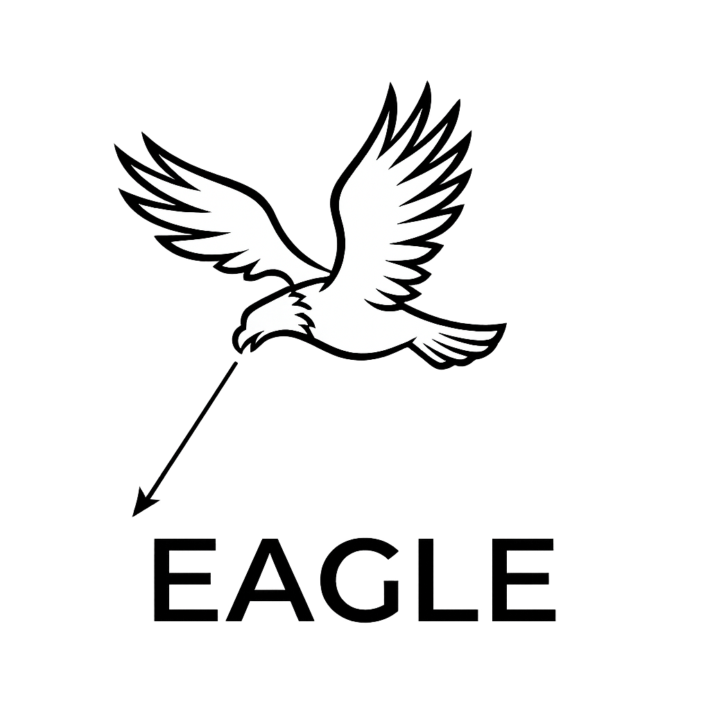
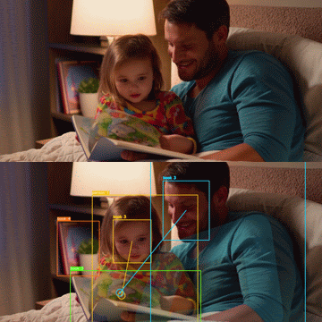
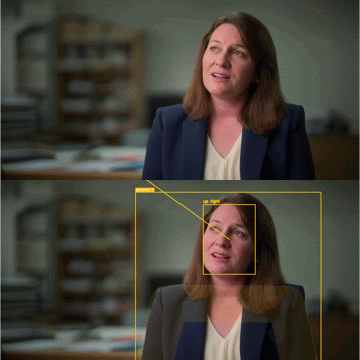
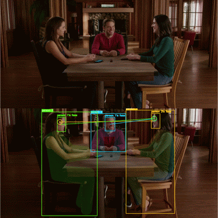
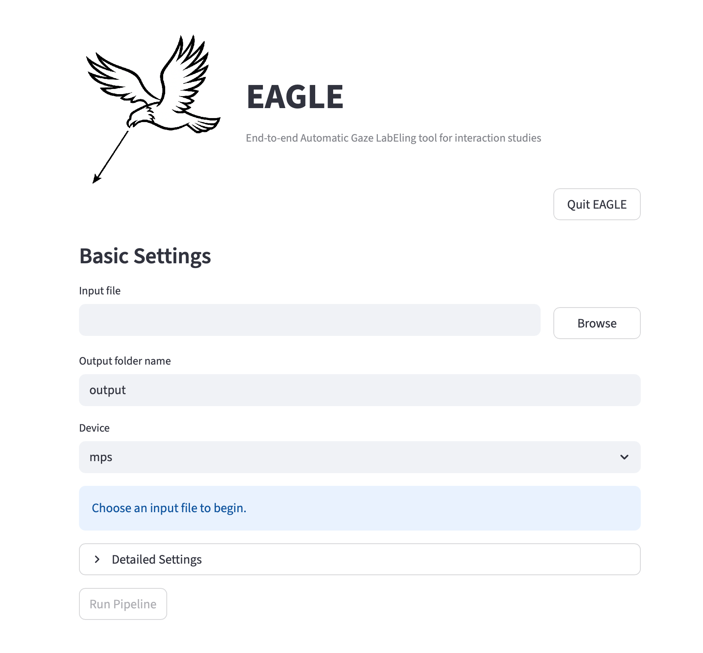

# EAGLE
<p align="center">
  <em><strong>E</strong>nd-to-end <strong>A</strong>utomatic <strong>G</strong>aze <strong>L</strong>ab<strong>E</strong>ling tool for interaction studies</em>
</p>

<p align="center">
  
</p>

## 言語

- [English](README.md)
- [日本語](README.ja.md)
- [简体中文](README.zh.md)
- [Español](README.es.md)

## 概要
EAGLE は、画像・動画解析向けの Streamlit ベース視線アノテーション支援ツールです。次の処理を組み合わせます。

- YOLO pose による人物追跡
- YOLO detection による非人物オブジェクト追跡
- デフォルトの RetinaFace、または選択可能な SCRFD・MediaPipe による顔検出
- デフォルトの PaGE、または選択可能な GAZELLE・GAZELLE-DINOv3 による視線ヒートマップ推定
- デフォルトの GaT、または選択可能な L2CS-Net・MobileOne gaze による画面外方向推定
- CSV 出力と、注釈付き画像・動画の出力

EAGLE はアノテーション支援ツールであり、正解データを保証するものではありません。研究、分析、報告、意思決定に使用する前に、すべての出力を必ず確認・検証してください。

## 出力例
<p align="center">
  
  
  
</p>

## GUI例
<p align="center">
  
</p>

## 現在のシステムでできること
入力画像または動画ごとに、現在のパイプラインは次を実行できます。

- pose 検出から人物を検出・追跡する
- すべての COCO オブジェクトクラスを保持する、または選択したクラスだけを保持する
- 追跡中の人物ごとに顔を 1 つ検出する
- 視線ヒートマップと視線点を推定する
- `left`、`up right`、`down`、`front` などの画面外方向ラベルを推定する（人物中心の向き）
- `annotation.csv` に ELAN 風の視線区間を生成する
- 設定が一致する場合、各フェーズのキャッシュを再利用する

人物検出では、EAGLE は pose keypoint も使い、可能な場合は視線を face、head、torso、arms、legs などの身体部位に割り当てます。

## 対応入力
- 画像: `.jpg`, `.jpeg`, `.png`, `.bmp`, `.tif`, `.tiff`, `.webp`
- 動画: `.mp4`, `.mov`, `.avi`, `.mkv`, `.m4v`, `.wmv`, `.webm`

## ダウンロード
ビルド済みアプリバンドルは GitHub Releases から取得できます。

- https://github.com/Taiga-Mori/EAGLE/releases

## セットアップ
仮想環境を作成して依存関係をインストールします。

```bash
python -m venv venv
source venv/bin/activate
pip install -r requirements.txt
```

推奨 Python バージョン: `3.10`

Google Colab（Python 3.12）では、代わりに Colab 用にバージョンを固定した requirements をインストールし、セッションを再起動してください。

```bash
pip install -r requirements-colab.txt
```

## アプリの起動
推奨:

```bash
python app.py
```

このランチャーは Streamlit を起動し、ブラウザでアプリを開きます。ポート `8501` が使えない場合は、近いポートを自動的に試します。

Streamlit を直接起動することもできます。

```bash
venv/bin/streamlit run app.py
```

## 初回起動とモデルダウンロード
初回利用時、EAGLE は必要に応じて次をダウンロードしてキャッシュします。

- 選択した YOLO object 重み: `yolo26n.pt`, `yolo26s.pt`, `yolo26m.pt`, `yolo26l.pt`, `yolo26x.pt` のいずれか
- `yolo26x-pose.pt`
- RetinaFace の学習済み重み
- GAZELLE またはカスタム GAZELLE モデル選択時: GAZELLE の torch.hub ファイル
- SCRFD 選択時: SCRFD の重み（`scrfd_10g_bnkps.onnx`）
- GAZELLE-DINOv3 選択時: 重み（`gazelle_dinov3_vitb16.pt`）と DINOv3 のモデルコード
- PaGE: Hugging Face（`Octopus1/page-vitb`）の重みとモデルコード
- L2CS-Net 選択時: `L2CSNet_gaze360.pkl`
- MobileOne 選択時: `mobileone_s0.pt`
- GaT: 重み（`gat_stwsge_gaze360_gf.ckpt`）と Omnivore の Swin3D のコード
- ffmpeg（libx264 対応の ffmpeg が PATH にない場合）: 環境に合った静的ビルド（Linux と Windows は BtbN、macOS は Martin Riedl のビルド）を `~/.EAGLE/ffmpeg/` に保存します

初回ロードに失敗した場合は、次を確認してください。

- マシンがオンラインであること
- GitHub / モデル配布エンドポイントに到達できること
- 現在のユーザーが `~/.EAGLE/` に書き込めること

## アプリのワークフロー
1. `python app.py` でアプリを起動します。
2. `Input file` を設定します。
   - macOS/Windows: `Browse` をクリックします。
   - Linux/Docker: `Container File Browser` を使うか、マウント済みパスを入力します。
3. 入力画像または動画を 1 つ選択します。
4. 検出されたメディア種別を確認します。
5. 必要に応じて `Output folder name` を編集します。
6. 必要に応じて `Detailed Settings` を開きます。
7. `Run Pipeline` をクリックします。
8. 最後に表示される出力パスを確認します。

出力ディレクトリの挙動:

- 入力ディレクトリに書き込み可能な場合、出力先の親ディレクトリは入力ファイルの親と同じです。
- 入力ディレクトリが読み取り専用の場合（Docker の `:ro` マウントでよくあります）、出力先は `/app/output/<input_stem>` にフォールバックします。
- デフォルトの出力フォルダ名は入力ファイルの stem です。
- 例:
  - 入力: `/data/session01/test.mp4`
  - 書き込み可能な親: `/data/session01/test`
  - 読み取り専用親のフォールバック: `/app/output/test`

## 主な設定

### Basic Settings
- `Input file`
  - macOS/Windows: 編集可能な欄で、`Browse` からもセットできます。
  - Linux/Docker: 編集可能な欄です（手入力でパス指定できます）。
- `Output folder name`
  - 入力ファイルの隣に作られるフォルダ名です。
- `Device`
  - NVIDIA GPU が複数ある場合は `cuda:0`, `cuda:1`, ... を使います（それ以外は `mps` または `cpu`）。

### Inference
- `Person detection backend`
  - `yolo26x-pose` です。
- `Object detection backend`
  - YOLO26 detection backend（`yolo26n`, `yolo26s`, `yolo26m`, `yolo26l`, `yolo26x`）を選択します。ダウンロード済みの重みは再利用のため `~/.EAGLE/` に保持されます。
- `Face detection backend`
  - デフォルトは `retinaface` です。SCRFD を使う場合は `scrfd`、MediaPipe を使いたい場合は `mediapipe` を選びます。`yolo-pose` を選ぶと顔検出を行わず、YOLO の姿勢キーポイント（鼻・目・耳）から頭部ボックスを作ります。最も高速で、ベンチマークでは検出した顔と同等に機能しました。`retinaface` と `mediapipe` は、姿勢から推定した各人物の頭のまわりを拡大して切り出した画像で顔を検出します。広角映像の小さい顔も検出でき、フレーム全体で検出するより高速です。`scrfd` はフレーム全体で検出します。
- `Gaze detection backend`
  - デフォルトは `page_vitb`（PaGE、DINOv3 ViT-B）です。ほかに `gazelle`（公式の GAZELLE 学習済みモデル、DINOv2 ViT-L）、`gazelle_dinov3_vitb16`（GAZELLE-DINOv3、DINOv3 ViT-B）、または `~/.EAGLE/custom/gaze/` に置いたファインチューニング済み GAZELLE モデルです。
- `Head pose detection backend`
  - 画面外を見ている人の視線方向を推定します。デフォルトは `gat`（GaT、ST-WSGE、CVPR 2025）です。GaT は頭部画像から3次元の視線を推定するため、顔が横向きや後ろ向きでも推定できます。顔画像から視線を推定する場合は `l2cs`、以前の MobileOne ベースのモデルを使う場合は `mobileone` を選びます。
- `Person threshold`, `Object threshold`, `Face threshold`, `Gaze threshold`
  - 人物姿勢追跡、人物以外のオブジェクト追跡、顔検出、視線 in/out 解釈に個別に使うしきい値です。
- `Visualization mode`
  - `both`, `point`, `heatmap`
- `Heatmap alpha`
  - ヒートマップ出力の重ね合わせ強度です。
- `Gaze target radius (px)`
  - `0` は点のみでターゲット割り当てを行います。大きい値では視線点の周囲円を使います。
- `Person part distance scale`
  - 視線が人物の keypoint からどれくらい離れていても身体部位として扱うかを制御します。
- `Person part keypoint min confidence`
  - 身体部位判定に使う pose keypoint confidence の下限です。デフォルトは `0.0` です。
- `Reuse existing persons.csv/objects.csv/faces.csv/gaze.csv when available`
  - メタデータが現在の実行と一致する場合、各フェーズのキャッシュを個別に再利用します。
- `Track all object classes`
  - オフにすると、保持する COCO クラスを明示的に選択できます。

### Temporal Settings
- `Person smoothing window`
  - 人物 bbox に対する平滑化窓です。
- `Merge duplicate and switched person tracks`、`Duplicate track IoU`、`ID switch max gap (seconds)`
  - 動画のみ・既定で有効。同じ人物を囲むトラック（共通フレームの80%以上で IoU 0.6 以上、または一方の bbox が他方に含まれ頭部が一致）を長い方に統合し、別のトラックの終了から3秒以内に同じ位置・同程度の大きさで始まるトラックをその続き（ID の切り替わり）として連結します。間は補間します。後処理前のトラックは `persons_raw.csv` に残り、これらの設定を変えた場合は後処理だけを再実行します。
- `Min person duration for gaze estimation (fraction of video)`
  - 動画のみ・既定は 0.5。後処理の後、動画全体のこの割合未満しか映っていない人物トラック（通りがかりの人や誤検出の断片）を `persons.csv` から除きます。除いた人物は視線推定を行わず、視線先にもなりません。途中で人が出入りする動画などで全員を残す場合は 0 にしてください。
- `Object smoothing window`
  - 追跡オブジェクトの bbox に対する平滑化窓です。
- `Face smoothing window`
  - 補間済みの顔 bbox に対する平滑化窓です。
- `Gaze point smoothing (seconds, 0=disabled)`
  - 動画のみ・既定は 0.1。注視対象を決める前に、各人物の視線点を、この長さを標準偏差とする中心型のガウスフィルタで時間方向に平滑化します。中心型なので、視線の移動を遅らせずに一瞬の跳びを除けます。ベンチマークでは Cohen の κ が約 0.02 上がり、ラベルの切り替え回数が半分ほどになって人手の注釈に近づきました。因果的なフィルタ（指数平滑化、One Euro）やラベル単位の平滑化は効果がありませんでした。描画動画・`gaze.csv`・`annotation.csv` はすべて平滑化後の視線点を使います。値を変えてもキャッシュ済みのヒートマップを再利用するので、視線モデルは再実行しません。
- `Person frame FPS`, `Object frame FPS`, `Face frame FPS`, `Gaze frame FPS`, `Head pose frame FPS`
  - 動画のみ。各ステージを指定した target FPS で実行し、それぞれの中間生成物を書き出します。既定はすべてのステージで 15 FPS（動画の FPS の方が低ければ動画の FPS）です。ベンチマークでは全フレーム処理と同じ精度でした。

重要:

- 後段ステージの FPS は、前段ステージの設定が同じなら前段キャッシュを無効化せずに変更できます。Track、face、gaze、head pose は各ステージ実行後に補間または平滑化されます。
- 内部的には、target FPS 値は元動画の FPS から frame stride に変換されます。

### BoT-SORT
UI では [`config/botsort.yaml`](config/botsort.yaml) の以下の tracker 設定を変更できます。

- `track_high_thresh`
- `track_low_thresh`
- `new_track_thresh`
- `track_buffer`
- `match_thresh`
- `Enable ReID`
- `proximity_thresh`
- `appearance_thresh`

## ベンチマーク
[千葉大学3人会話コーパス](https://research.nii.ac.jp/src/Chiba3Party.html) の12セッション（着席した3人、広角カメラ1台、720x480、1セッション9.4分）で、人手の視線アノテーションとの一致を比較しました。各参加者の各フレームのラベルは、見ている相手（その人の顔への視線）または *none* です。アノテータが視線移動中とした区間は評価から除いています。時間は NVIDIA GeForce RTX 3090 1枚でのセッションあたりの中央値で、人物トラッキング（3.4分）を含むパイプライン全体の時間です（動画の描画は含みません）。頭部ボックスの `YOLO pose` は骨格キーポイントから作ったもの（`yolo-pose`）、それ以外は顔検出器の結果です。

| 視線モデル | 頭部ボックス | FPS | 注視点の平滑化 | Cohen の κ | マクロF1 | 時間（分） |
|---|---|---|---|---|---|---|
| PaGE | YOLO pose | 1 | あり | 0.463 | 0.594 | 5.3 |
| PaGE | YOLO pose | 10 | あり | **0.522** | 0.642 | 8.5 |
| PaGE | YOLO pose | 15 | あり | **0.522** | **0.643** | 9.9 |
| PaGE | YOLO pose | 15 | なし | 0.504 | 0.617 | 9.9 |
| PaGE | SCRFD | 15 | なし | 0.499 | 0.613 | 10.9 |
| PaGE | RetinaFace | 15 | なし | 0.497 | 0.610 | 15.6 |
| PaGE | MediaPipe | 15 | なし | 0.494 | 0.606 | 18.1 |
| GAZELLE | YOLO pose | 15 | なし | 0.380 | 0.511 | 8.3 |
| GAZELLE-DINOv3 | YOLO pose | 15 | なし | 0.364 | 0.498 | 7.7 |

- 精度は視線モデルでほぼ決まります。PaGE は12セッションすべてで GAZELLE と GAZELLE-DINOv3 を κ で0.12〜0.14上回りました。
- 骨格キーポイントから作った頭部ボックス（`yolo-pose`）は、検出した顔と同等に機能し（4種の差は κ 0.011以内）、追加のモデルも不要です。顔検出器は時間が増えるだけで、RetinaFace と MediaPipe が最も遅い結果でした。
- 10 FPS でも 15 FPS や全フレーム処理と同じ精度で、約15%速くなります。1 FPS でもその約9割の精度を保ちます。
- 注視点の平滑化（既定0.1秒）で κ が約0.02上がり、ラベルの切り替わりが毎分69回から39回に減ります。人手のアノテーションは毎分35回でした。
- 動画の描画には、注視点（`point`）で1セッションあたり約1.8分、人ごとのヒートマップも出す場合（`both`）で約5.5分が追加でかかります。
- カメラに正対する人（κ 0.72）は、横から映る人（κ 約0.40）より大幅に精度が高くなります。

## 高速化のヒント
- NVIDIA GPU が使える環境では `cuda:*`、Apple Silicon では利用可能なら `mps` を使ってください。
- 各ステージの FPS を下げると処理量を減らせます。特に視線以外のステージで効果が出やすいです。
- `yolo-pose` は顔検出そのものを省きます。顔検出器の中では `scrfd` が最も高速です。
- 視線モデルは複数フレームをまとめて推論し、CUDA では float16 を使います（既定で `gaze_half_precision=True`）。CUDA では、1フレームずつ float32 で推論するより約3倍速く、結果は同じです。Apple の MPS では float32 のままです。M3 では float16 にすると 64x64 のヒートマップ上でピークが最大 50 px ずれ（GAZELLE-DINOv3）、速くもなりませんでした。
- Apple の MPS では、attention 層を PyTorch の SDPA カーネルではなく通常の行列積で計算します。M3 では結果を変えずに視線モデルが 25〜30% 速くなりました。
- Apple Silicon（`mps`）では、YOLO・RetinaFace・PaGE を Core ML で実行します（YOLO と RetinaFace は Neural Engine、PaGE は GPU）。M3 の MacBook Air では、3人が映る20秒の動画（15 FPS）が 6分23秒 から 1分50秒 になり、追跡結果と視線点は変わりませんでした（人物ボックスの IoU 0.996、PaGE のヒートマップのピークは PyTorch との差が2セル以内）。モデルは初回に一度だけ変換され（数分）、`~/.EAGLE/coreml` に保存されます。PyTorch だけで実行するには `EAGLE_DISABLE_COREML=1` を設定してください。その場合 YOLO と RetinaFace は MPS 上で float16 で動きます。
- 人物と物体の追跡では、YOLO を16フレームずつまとめて推論し、CUDA では float16 を使います。ベンチマークでは結果を変えずに追跡時間が約半分になりました。
- CSV と ELAN 用の出力だけが必要な場合は、`Render visualization videos` をオフ（`render_video=False`）にすると、注釈付き動画の描画とエンコードを省けます。

## 出力ファイル
現在の出力には次が含まれます。

- `persons.csv`
  - 重複・ID 切り替わりを統合した後の平滑化済み人物追跡結果（後段で使用。統合内容は `.persons_meta.json` に記録）
- `persons_raw.csv`
  - その後処理を行う前の平滑化済み人物追跡結果
- `.persons_meta.json`
  - person cache 再利用検証用のメタデータ
- `objects.csv`
  - 平滑化済みの非人物オブジェクト追跡結果
- `.objects_meta.json`
  - object cache 再利用検証用のメタデータ
- `faces.csv`
  - 人物 track に対応付けられた顔検出 bbox
- `.faces_meta.json`
  - face cache 再利用検証用のメタデータ
- `gaze.csv`
  - 視線点（補間・平滑化済み。`Gaze point smoothing` を参照）、in/out 確率、画面外方向フィールド
- `gaze_heatmaps.npz`
  - サンプリングしたフレームの視線ヒートマップのキャッシュ（float16。間のフレームはキャッシュ再利用時に補間し直します）
- `.gaze_meta.json`
  - gaze cache 再利用検証用のメタデータ
- `annotation.csv`
  - ELAN 風の視線区間、または単一画像ラベル
- `all_points.jpg`
  - 画像入力用の point 可視化
- `all_points.mp4`
  - 動画入力用の point 可視化
- `person_<track_id>_heatmap.jpg`
  - 画像入力用の人物別ヒートマップ出力
- `person_<track_id>_heatmap.mp4`
  - 動画入力用の人物別ヒートマップ出力

`temp/` や `heatmaps/` などの一時フォルダは export 後に削除されます。

## CSV の内容
`persons.csv` の列:

- `frame_idx`
- `cls`
- `track_id`
- `object_detected`
- `source`
- `conf`
- `x1`, `y1`, `x2`, `y2`
- `pose_keypoints`
- `label`

`objects.csv` の列:

- `frame_idx`
- `cls`
- `track_id`
- `object_detected`
- `source`
- `conf`
- `x1`, `y1`, `x2`, `y2`
- `pose_keypoints`
- `label`

`faces.csv` の列:

- `frame_idx`
- `track_id`
- `face_detected`
- `face_conf`
- `face_x1`, `face_y1`, `face_x2`, `face_y2`

`gaze.csv` の列:

- `frame_idx`
- `track_id`
- `gaze_detected`
- `inout`
- `x_gaze`, `y_gaze`
- `offscreen_direction`
- `offscreen_yaw`
- `offscreen_pitch`

`annotation.csv` の列:

- `tier`
- `start_time`
- `end_time`
- `gaze`

## 開発用エントリポイント
- [`app.py`](app.py)
  - Streamlit UI とランチャー
- [`main.py`](main.py)
  - ローカル用の最小スモークテスト入口
- [`eagle/pipeline.py`](eagle/pipeline.py)
  - メインの Python API facade

最小コード例:

```python
from eagle import EAGLE

eagle = EAGLE()
eagle.preprocess(
    input_path="input.mp4",
    output_dir="output_dir",
    person_target_fps=15,
    object_target_fps=15,
    face_target_fps=15,
    gaze_target_fps=15,
    head_pose_target_fps=15,
    person_det_thresh=0.5,
    object_det_thresh=0.5,
    face_det_thresh=0.5,
    gaze_det_thresh=0.5,
    person_detection_backend="yolo26x-pose",
    object_detection_backend="yolo26x",
    face_detection_backend="retinaface",
    gaze_detection_backend="page_vitb",
    head_pose_detection_backend="gat",
    device="cpu",
    visualization_mode="both",
    person_part_min_conf=0.0,
    person_max_switch_gap=15,
)
results = eagle.run_all()
```

## 免責事項
- このソフトウェアは自己責任で使用してください。
- EAGLE は検出、視線推定、ターゲット割り当て、エクスポートされた注釈の正確性を保証しません。
- 最終的な確認と修正の責任はユーザーにあります。

## ライセンス
このプロジェクトは `AGPL-3.0-or-later` でライセンスされています。リポジトリのライセンス本文は [LICENSE](LICENSE) を参照してください。

実行時にダウンロードするモデルには、それぞれのライセンスが適用されます。

- GAZELLE、GAZELLE-DINOv3、PaGE のコードと重み: MIT License。
- GAZELLE-DINOv3 と PaGE の重みは DINOv3 を含む、またはそれに由来するため、[DINOv3 License](https://github.com/facebookresearch/dinov3/blob/main/LICENSE.md) も適用されます（再配布時のライセンス同梱、論文での DINOv3 使用の明記、軍事利用の禁止など）。
- SCRFD の重みは InsightFace のもので、学習済みモデルは非商用の研究目的に限って提供されています。
- GaT の重みと Omnivore の Swin3D のコードは CC BY-NC 4.0（非商用に限る）です。

## 謝辞
- Ultralytics YOLO
  - https://docs.ultralytics.com/
- BoT-SORT
  - https://github.com/NirAharon/BoT-SORT
- MediaPipe
  - https://developers.google.com/mediapipe
- RetinaFace
  - https://github.com/serengil/retinaface
- GAZELLE
  - https://github.com/fkryan/gazelle
- GAZELLE-DINOv3
  - https://github.com/PINTO0309/gazelle-dinov3
- PaGE
  - https://github.com/OctopusWen/PaGE
- DINOv3
  - https://github.com/facebookresearch/dinov3
- SCRFD (InsightFace)
  - https://github.com/deepinsight/insightface
- GaT / ST-WSGE (3D gaze estimation)
  - https://github.com/idiap/gaze3d
- L2CS-Net
  - https://github.com/Ahmednull/L2CS-Net
- MobileOne gaze-estimation weights
  - https://github.com/yakhyo/gaze-estimation
