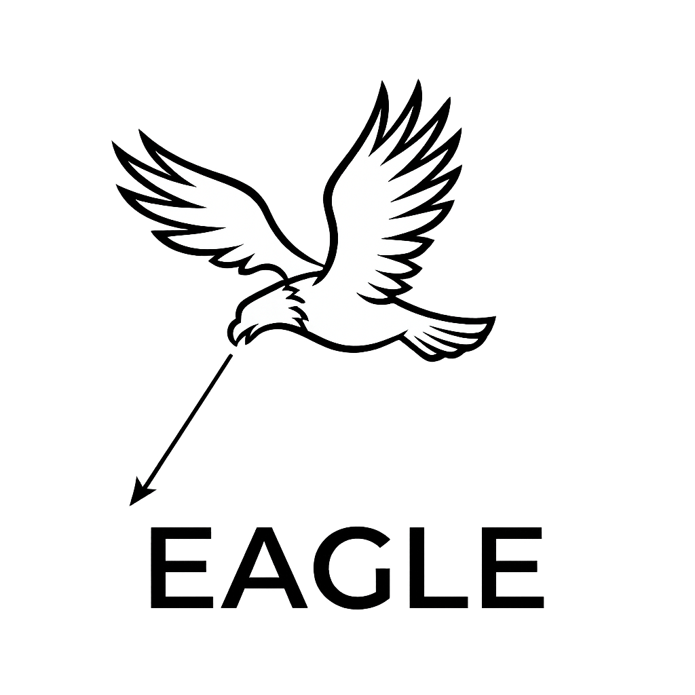
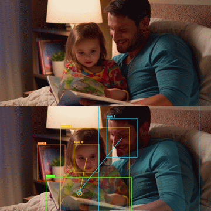
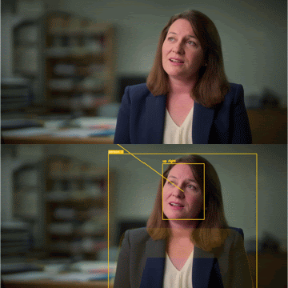
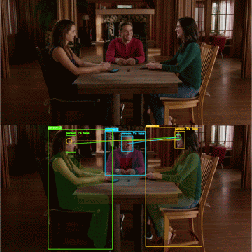
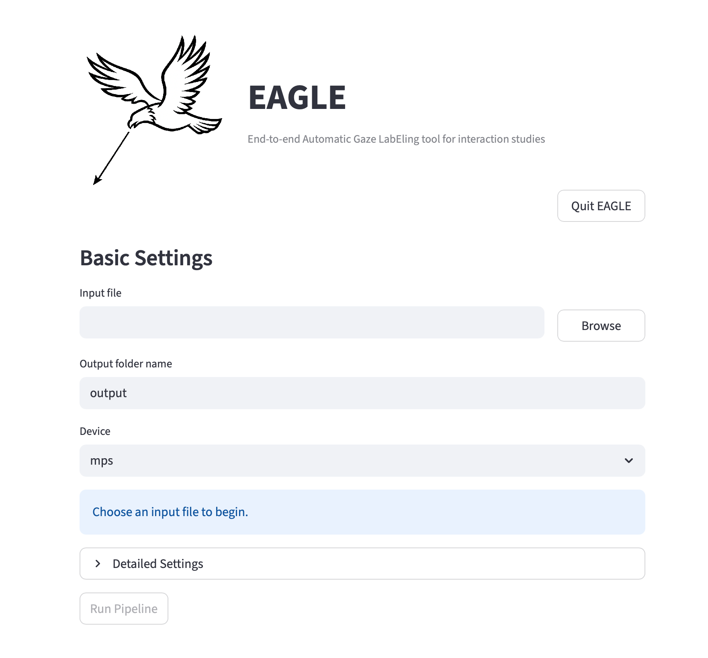

# EAGLE
<p align="center">
  <em><strong>E</strong>nd-to-end <strong>A</strong>utomatic <strong>G</strong>aze <strong>L</strong>ab<strong>E</strong>ling tool for interaction studies</em>
</p>

<p align="center">
  
</p>

## 语言

- [English](README.md)
- [日本語](README.ja.md)
- [简体中文](README.zh.md)
- [Español](README.es.md)

## 概述
EAGLE 是一个基于 Streamlit 的视线标注辅助工具，用于图像和视频分析。它结合了：

- 使用 YOLO pose 进行人物跟踪
- 使用 YOLO detection 进行非人物对象跟踪
- 默认使用 SCRFD 进行人脸检测，也可以选择 RetinaFace 或 MediaPipe，或由姿态关键点生成头部框
- 默认使用 PaGE 进行视线热力图估计，也可以选择 GAZELLE 或 GAZELLE-DINOv3
- 默认使用 GaT 进行画面外方向估计，也可以选择 L2CS-Net 或 MobileOne gaze
- CSV 导出以及带标注的图像/视频导出

EAGLE 是标注辅助工具，并不保证输出就是真实标注。在用于研究、分析、报告或决策之前，必须检查并验证所有输出。

## 输出示例
<p align="center">
  
  
  
</p>

## GUI 示例
<p align="center">
  
</p>

## 当前系统的功能
对于每个输入图像或视频，当前流程可以：

- 从姿态检测结果中检测并跟踪人物
- 可选择保留所有 COCO 对象类别，或只保留选定类别
- 为每个被跟踪的人物检测一个人脸
- 估计视线热力图和视线点
- 推断 `left`、`up right`、`down`、`front` 等画面外方向标签（以人物自身方向为基准）
- 在 `annotation.csv` 中生成 ELAN 风格的视线片段
- 当设置仍然匹配时，复用各阶段缓存

对于人物检测，EAGLE 还会使用 pose keypoints，在可能时把视线分配到 face、head、torso、arms、legs 等身体部位。

## 支持的输入
- 图像: `.jpg`, `.jpeg`, `.png`, `.bmp`, `.tif`, `.tiff`, `.webp`
- 视频: `.mp4`, `.mov`, `.avi`, `.mkv`, `.m4v`, `.wmv`, `.webm`

## 下载
预构建应用包可从 GitHub Releases 获取：

- https://github.com/Taiga-Mori/EAGLE/releases

## 安装
创建虚拟环境并安装依赖：

```bash
python -m venv venv
source venv/bin/activate
pip install -r requirements.txt
```

推荐 Python 版本：`3.10`

在 Google Colab（Python 3.12）上，请改为安装为 Colab 固定版本的依赖，然后重启会话：

```bash
pip install -r requirements-colab.txt
```

## 启动应用
推荐方式：

```bash
python app.py
```

该启动器会为你启动 Streamlit，并在浏览器中打开应用。如果端口 `8501` 不可用，它会自动尝试附近端口。

也可以直接运行 Streamlit：

```bash
venv/bin/streamlit run app.py
```

### 在远程 GPU 服务器上使用
应用在浏览器中运行，因此可以在 GPU 服务器上启动，并在自己的电脑上操作。在服务器上以只接受本机连接的方式启动：

```bash
venv/bin/streamlit run app.py --server.address 127.0.0.1 --server.port 8501 --server.headless true
```

然后在自己的电脑上通过 SSH 转发端口，并打开 http://localhost:8501：

```bash
ssh -N -L 8501:localhost:8501 user@gpu-server
```

输入文件使用服务器上的路径（直接输入或用文件浏览器选择），输出也写在服务器上。应用本身没有登录功能，请使用 SSH 隧道，而不要把端口开放到网络上。

## 首次运行和模型下载
首次使用时，EAGLE 可能会下载并缓存：

- 按需使用的 YOLO object 权重：`yolo26n.pt`、`yolo26s.pt`、`yolo26m.pt`、`yolo26l.pt` 或 `yolo26x.pt`
- `yolo26x-pose.pt`
- RetinaFace 预训练权重
- 选择 GAZELLE 或自定义 GAZELLE 模型时：GAZELLE torch.hub 文件
- 选择 SCRFD 时：SCRFD 权重（`scrfd_10g_bnkps.onnx`）
- 选择 GAZELLE-DINOv3 时：权重（`gazelle_dinov3_vitb16.pt`）和 DINOv3 模型代码
- PaGE：来自 Hugging Face（`Octopus1/page-vitb`）的权重和模型代码
- 选择 L2CS-Net 时：`L2CSNet_gaze360.pkl`
- 选择 MobileOne 时：`mobileone_s0.pt`
- GaT：权重（`gat_stwsge_gaze360_gf.ckpt`）和 Omnivore 的 Swin3D 代码
- ffmpeg（PATH 中没有支持 libx264 的 ffmpeg 时）：下载适合当前平台的静态构建（Linux 和 Windows 使用 BtbN，macOS 使用 Martin Riedl 的构建），保存到 `~/.EAGLE/ffmpeg/`

如果首次加载失败，请检查：

- 机器是否联网
- 是否能访问 GitHub / 模型托管端点
- 当前用户是否可以写入 `~/.EAGLE/`

## 应用工作流
1. 使用 `python app.py` 启动应用。
2. 设置 `Input file`：
   - macOS/Windows：点击 `Browse`。
   - Linux/Docker：使用 `Container File Browser`，或输入已挂载路径。
3. 选择一个输入图像或视频。
4. 确认检测到的媒体类型。
5. 如有需要，编辑 `Output folder name`。
6. 如有需要，打开 `Detailed Settings`。
7. 点击 `Run Pipeline`。
8. 查看最后显示的输出路径。

输出目录行为：

- 如果输入目录可写，输出父目录与输入文件的父目录相同。
- 如果输入目录只读（Docker `:ro` 挂载中常见），输出会回退到 `/app/output/<input_stem>`。
- 默认输出文件夹名是输入文件的 stem。
- 示例：
  - 输入: `/data/session01/test.mp4`
  - 可写父目录: `/data/session01/test`
  - 只读父目录回退: `/app/output/test`

## 主要设置

### Basic Settings
- `Input file`
  - macOS/Windows：可编辑字段，也可以由 `Browse` 填入。
  - Linux/Docker：可编辑字段（支持手动输入路径）。
- `Output folder name`
  - 在输入文件旁边创建的文件夹名称。
- `Device`
  - 当有多个 NVIDIA GPU 时使用 `cuda:0`, `cuda:1`, ...（否则使用 `mps` 或 `cpu`）。

### Inference
- `Person detection backend`
  - `yolo26x-pose`。
- `Object detection backend`
  - 选择 YOLO26 detection backend（`yolo26n`、`yolo26s`、`yolo26m`、`yolo26l` 或 `yolo26x`）。已下载的权重会保留在 `~/.EAGLE/` 中以便复用。
- `Face detection backend`
  - 默认是 `scrfd`（SCRFD）；使用 RetinaFace 时选择 `retinaface`，使用 MediaPipe 时选择 `mediapipe`。选择 `yolo-pose` 时不进行人脸检测，而是由 YOLO 姿态关键点（鼻子、眼睛、耳朵）生成头部框；它速度最快，在基准测试中与检测到的人脸效果相当。`retinaface` 和 `mediapipe` 会在根据姿态估计出的每个人头部周围放大裁剪的图像上检测人脸，能检测广角画面中的小脸，并且比在整帧上检测更快；`scrfd` 在整帧上检测。
- `Gaze detection backend`
  - 默认是 `page_vitb`（PaGE，DINOv3 ViT-B）；也可以选择 `gazelle`（官方 GAZELLE 预训练模型，DINOv2 ViT-L）、`gazelle_dinov3_vitb16`（GAZELLE-DINOv3，DINOv3 ViT-B），或放在 `~/.EAGLE/custom/gaze/` 中的微调 GAZELLE 模型。
- `Head pose detection backend`
  - 估计注视画面外的人的视线方向。默认是 `gat`（GaT，ST-WSGE，CVPR 2025）。GaT 从头部图像估计三维视线，因此即使人脸是侧面或背面也能估计。从人脸图像估计视线时选择 `l2cs`；使用之前的 MobileOne 模型时选择 `mobileone`。
- `Person threshold`, `Object threshold`, `Face threshold`, `Gaze threshold`
  - 分别用于人物姿态跟踪、非人物对象跟踪、人脸检测和视线 in/out 解释的阈值。
- `Visualization mode`
  - `both`, `point`, `heatmap`
- `Heatmap alpha`
  - 热力图输出的叠加强度。
- `Gaze target radius (px)`
  - `0` 表示只用点进行目标分配。更大的值会使用视线点周围的圆形区域。
- `Person part distance scale`
  - 控制视线距离人物 keypoint 多远时仍可被视为对应身体部位。
- `Person part keypoint min confidence`
  - 用于身体部位分配的 pose keypoint confidence 下限。默认值为 `0.0`。
- `Reuse existing persons.csv/objects.csv/faces.csv/gaze.csv when available`
  - 当元数据仍匹配当前运行时，分别复用各阶段缓存。
- `Track all object classes`
  - 关闭时，可以明确选择要保留的 COCO 类别。

### Temporal Settings
- `Person smoothing window`
  - 人物框的平滑窗口。
- `Merge duplicate and switched person tracks`、`Duplicate track IoU`、`ID switch max gap (seconds)`
  - 仅限视频，默认开启。将框住同一人物的轨迹（在共同帧中至少 80% 的帧 IoU 不低于 0.6，或一个框位于另一个框内且头部位置一致）合并到较长的轨迹中；若某条轨迹在另一条轨迹结束后 3 秒内、在相同位置以相近大小出现，则视为其延续（ID 切换）并连接。中间的空缺通过插值补全。后处理前的轨迹保存在 `persons_raw.csv` 中，修改这些设置时只会重新执行后处理。
- `Min person duration for gaze estimation (fraction of video)`
  - 仅限视频，默认 0.5。后处理之后，出现时间少于视频全长该比例的人物轨迹（路过的人、残留的误检片段）会从 `persons.csv` 中移除：不对其进行视线估计，也不作为视线目标。如需保留所有人（例如视频中途有人进出），请设为 0。
- `Object smoothing window`
  - 跟踪对象框的平滑窗口。
- `Face smoothing window`
  - 插值后人脸框的平滑窗口。
- `Gaze point smoothing (seconds, 0=disabled)`
  - 仅限视频，默认 0.1。在确定注视目标之前，用以该长度为标准差的中心高斯滤波器在时间上平滑每个人的视线点。由于是中心滤波，可以去除短暂的跳变而不延迟视线转移。在我们的基准测试中，宏平均F1提高约 0.02，Cohen 的 κ 提高 0.01-0.02，标签切换次数减少三分之一到一半，接近人工标注；因果滤波器（指数平滑、One Euro）和标签层面的平滑没有效果。渲染视频、`gaze.csv` 和 `annotation.csv` 都使用平滑后的视线点。修改该值时会复用缓存的热力图，不会重新运行视线模型。
- `Person frame FPS`, `Object frame FPS`, `Face frame FPS`, `Gaze frame FPS`, `Head pose frame FPS`
  - 仅视频。每个阶段按所选 target FPS 运行，并写出自己的中间输出。所有阶段默认 10 FPS（若视频 FPS 更低则使用视频 FPS）；在我们的基准测试中，这与逐帧处理的一致性相同。

重要：

- 后续阶段的 FPS 可以在自身设置不变时调整，而不会使前序阶段缓存失效。Track、face、gaze 和 head pose 会在各阶段运行后进行插值或平滑。
- 在内部，target FPS 会根据源 FPS 转换为 frame stride。

### BoT-SORT
UI 暴露了 [`config/botsort.yaml`](config/botsort.yaml) 中的这些 tracker 设置：

- `track_high_thresh`
- `track_low_thresh`
- `new_track_thresh`
- `track_buffer`
- `match_thresh`
- `Enable ReID`
- `proximity_thresh`
- `appearance_thresh`

## 基准测试
我们在[千叶大学三人会话语料库](https://research.nii.ac.jp/src/en/Chiba3Party.html)的12个会话（三名就座参与者、一台广角摄像机、720x480、每个会话9.4分钟）上，将各配置与人工视线标注进行了比较。每名参与者每一帧的标签为其注视的另一名参与者（注视该人的脸部）或 *none*；标注者标为视线转移的帧不参与评估。时间为单块 NVIDIA GeForce RTX 3090 上每个会话的中位数，涵盖整个流程，包括人物跟踪（3.4分钟），但不包括视频渲染。头部框为 `YOLO pose` 时由姿态关键点生成（`yolo-pose`），其余由人脸检测器得到。

| 视线模型 | 头部框 | FPS | 视线点平滑 | Cohen's κ | 宏平均F1 | 时间（分钟） |
|---|---|---|---|---|---|---|
| PaGE | SCRFD | 10（默认） | 开 | 0.512 | 0.635 | 9.1 |
| PaGE | YOLO pose | 1 | 开 | 0.463 | 0.594 | 5.3 |
| PaGE | YOLO pose | 10 | 开 | **0.522** | 0.642 | 8.5 |
| PaGE | YOLO pose | 15 | 开 | **0.522** | **0.643** | 9.9 |
| PaGE | YOLO pose | 15 | 关 | 0.504 | 0.617 | 9.9 |
| PaGE | SCRFD | 15 | 关 | 0.499 | 0.613 | 10.9 |
| PaGE | RetinaFace | 15 | 关 | 0.497 | 0.610 | 15.6 |
| PaGE | MediaPipe | 15 | 关 | 0.494 | 0.606 | 18.1 |
| GAZELLE | YOLO pose | 15 | 关 | 0.380 | 0.511 | 8.3 |
| GAZELLE-DINOv3 | YOLO pose | 15 | 关 | 0.364 | 0.498 | 7.7 |

使用默认人脸检测器 SCRFD 时所有视线模型和帧率的结果（不使用视线点平滑，时间包括人物跟踪）：

| 视线模型 | FPS | Cohen's κ | 宏平均F1 | 时间（分钟） |
|---|---|---|---|---|
| GAZELLE | 1 | 0.360 | 0.503 | 5.3 |
| GAZELLE | 10 | 0.381 | 0.517 | 8.1 |
| GAZELLE | 15 | 0.381 | 0.517 | 9.3 |
| GAZELLE | 29.97 | 0.381 | 0.517 | 13.4 |
| GAZELLE-DINOv3 | 1 | 0.348 | 0.491 | 5.2 |
| GAZELLE-DINOv3 | 10 | 0.368 | 0.504 | 7.6 |
| GAZELLE-DINOv3 | 15 | 0.368 | 0.504 | 8.5 |
| GAZELLE-DINOv3 | 29.97 | 0.368 | 0.503 | 12.0 |
| PaGE | 1 | 0.453 | 0.582 | 5.4 |
| PaGE | 10 | **0.499** | **0.613** | 9.1 |
| PaGE | 15 | **0.499** | **0.613** | 10.8 |
| PaGE | 29.97 | 0.498 | 0.612 | 16.3 |

- 视线模型影响最大：PaGE 在全部12个会话中都比 GAZELLE 和 GAZELLE-DINOv3 高0.12-0.14 κ。
- 由姿态关键点生成的头部框（`yolo-pose`）与检测到的人脸效果相当（四种方式相差不超过0.011 κ），且无需额外模型。人脸检测器只会增加时间，其中 RetinaFace 和 MediaPipe 最慢。
- 10 FPS 与 15 FPS 及逐帧处理的一致性相同，且快约15%；1 FPS 保留了约90%的一致性。
- 视线点平滑（默认0.1秒）使宏平均F1提高约0.02、κ 提高0.01-0.02，主要是因为短暂的 *none* 区间不再被打断；在默认设置下，标签切换从每分钟56次减少到36次，接近人工标注的35次。
- 渲染视频时，每个会话在绘制视线点（`point`）时约增加1.8分钟，同时输出每人热图（`both`）时约增加5.5分钟。
- 正对摄像机的人的一致性远高于从侧面拍到的人。默认设置下的结果：

| 参与者 | Cohen's κ | 宏平均F1 |
|---|---|---|
| A（左侧，侧面） | 0.388 | 0.546 |
| B（中间，正对摄像机） | 0.734 | 0.811 |
| C（右侧，侧面） | 0.413 | 0.547 |

  当 A 或 C 没有看另外两人时，约一半的帧被判为在看 B，因为在画面中 B 的头部位于其视线延长线上；EAGLE 判为 *none* 的比例在 A 为16%、C 为9%，远低于人工标注的40%和35%。

## 加速提示
- 在 NVIDIA GPU 上使用 `cuda:*`；在 Apple Silicon 上如可用则使用 `mps`。
- 降低各阶段 FPS 可以减少重复检测工作，尤其是 gaze 以外的阶段。
- `yolo-pose` 完全跳过人脸检测；在人脸检测器中 `scrfd` 最快。
- 视线模型会一次处理多帧，在 CUDA 上使用 float16（默认 `gaze_half_precision=True`）；在 CUDA 上比逐帧 float32 推理快约 3 倍，结果相同。在 Apple MPS 上保持 float32：在 M3 上，float16 会使 64x64 热力图的峰值最多偏移 50 px（GAZELLE-DINOv3），而且并不更快。
- 在 Apple MPS 上，attention 层使用普通矩阵乘法而不是 PyTorch 的 SDPA 内核；在 M3 上视线模型快了 25-30%，结果相同。
- 在 Apple Silicon（`mps`）上，YOLO、RetinaFace 和 PaGE 通过 Core ML 运行（YOLO 和 RetinaFace 在神经网络引擎上，PaGE 在 GPU 上）。在 M3 MacBook Air 上，一段 3 人、20 秒、15 FPS 的视频从 6:23 缩短到 1:50，跟踪结果和视线点不变（人物框 IoU 0.996，PaGE 热力图峰值与 PyTorch 相差不超过 2 格）。模型在首次使用时转换一次（几分钟），并缓存在 `~/.EAGLE/coreml`。设置 `EAGLE_DISABLE_COREML=1` 可只使用 PyTorch；此时 YOLO 和 RetinaFace 在 MPS 上以 float16 运行。
- 人物和物体跟踪会让 YOLO 一次处理 16 帧，在 CUDA 上使用 float16；在我们的基准测试中，跟踪时间减半且结果相同。
- 如果只需要 CSV 和 ELAN 输出，可以关闭 `Render visualization videos`（`render_video=False`），跳过注释视频的绘制和编码。

## 输出文件
当前输出可能包括：

- `persons.csv`
  - 合并重复轨迹和 ID 切换后的平滑人物跟踪结果（供后续阶段使用；合并记录见 `.persons_meta.json`）
- `persons_raw.csv`
  - 上述后处理之前的平滑人物跟踪结果
- `.persons_meta.json`
  - 用于验证 person cache 复用的元数据
- `objects.csv`
  - 平滑后的非人物对象跟踪结果
- `.objects_meta.json`
  - 用于验证 object cache 复用的元数据
- `faces.csv`
  - 分配到人物 track 的人脸检测框
- `.faces_meta.json`
  - 用于验证 face cache 复用的元数据
- `gaze.csv`
  - 视线点（已插值并平滑，见 `Gaze point smoothing`）、in/out 概率和画面外方向字段
- `gaze_heatmaps.npz`
  - 采样帧的视线热力图缓存（float16；中间帧在复用缓存时重新插值）
- `.gaze_meta.json`
  - 用于验证 gaze cache 复用的元数据
- `annotation.csv`
  - ELAN 风格的视线片段或单图像标签
- `all_points.jpg`
  - 图像输入的点可视化
- `all_points.mp4`
  - 视频输入的点可视化
- `person_<track_id>_heatmap.jpg`
  - 图像输入的人物级热力图输出
- `person_<track_id>_heatmap.mp4`
  - 视频输入的人物级热力图输出

`temp/` 和 `heatmaps/` 等临时文件夹会在导出后删除。

## CSV 内容
`persons.csv` 列：

- `frame_idx`
- `cls`
- `track_id`
- `object_detected`
- `source`
- `conf`
- `x1`, `y1`, `x2`, `y2`
- `pose_keypoints`
- `label`

`objects.csv` 列：

- `frame_idx`
- `cls`
- `track_id`
- `object_detected`
- `source`
- `conf`
- `x1`, `y1`, `x2`, `y2`
- `pose_keypoints`
- `label`

`faces.csv` 列：

- `frame_idx`
- `track_id`
- `face_detected`
- `face_conf`
- `face_x1`, `face_y1`, `face_x2`, `face_y2`

`gaze.csv` 列：

- `frame_idx`
- `track_id`
- `gaze_detected`
- `inout`
- `x_gaze`, `y_gaze`
- `offscreen_direction`
- `offscreen_yaw`
- `offscreen_pitch`

`annotation.csv` 列：

- `tier`
- `start_time`
- `end_time`
- `gaze`

## 开发入口
- [`app.py`](app.py)
  - Streamlit UI 和启动器
- [`main.py`](main.py)
  - 最小本地 smoke-test 入口
- [`eagle/pipeline.py`](eagle/pipeline.py)
  - 主 Python API facade

最小代码用法：

```python
from eagle import EAGLE

eagle = EAGLE()
eagle.preprocess(
    input_path="input.mp4",
    output_dir="output_dir",
    person_target_fps=15,
    object_target_fps=15,
    face_target_fps=15,
    gaze_target_fps=15,
    head_pose_target_fps=15,
    person_det_thresh=0.5,
    object_det_thresh=0.5,
    face_det_thresh=0.5,
    gaze_det_thresh=0.5,
    person_detection_backend="yolo26x-pose",
    object_detection_backend="yolo26x",
    face_detection_backend="retinaface",
    gaze_detection_backend="page_vitb",
    head_pose_detection_backend="gat",
    device="cpu",
    visualization_mode="both",
    person_part_min_conf=0.0,
    person_max_switch_gap=15,
)
results = eagle.run_all()
```

## 免责声明
- 使用本软件需自行承担风险。
- EAGLE 不保证检测、视线估计、目标分配或导出标注的正确性。
- 最终审查和修正责任由用户承担。

## 许可证
本项目采用 `AGPL-3.0-or-later` 许可证。仓库许可证正文见 [LICENSE](LICENSE)。

运行时下载的模型适用各自的许可证：

- GAZELLE、GAZELLE-DINOv3 和 PaGE 的代码与权重：MIT License。
- GAZELLE-DINOv3 和 PaGE 的权重包含或源自 DINOv3，因此还适用 [DINOv3 License](https://github.com/facebookresearch/dinov3/blob/main/LICENSE.md)（例如再分发时附带许可证、在论文中注明使用 DINOv3、禁止军事用途）。
- SCRFD 权重来自 InsightFace，其预训练模型仅供非商业研究用途。
- GaT 权重和 Omnivore 的 Swin3D 代码采用 CC BY-NC 4.0 许可证（仅限非商业用途）。

## 致谢
- Ultralytics YOLO
  - https://docs.ultralytics.com/
- BoT-SORT
  - https://github.com/NirAharon/BoT-SORT
- MediaPipe
  - https://developers.google.com/mediapipe
- RetinaFace
  - https://github.com/serengil/retinaface
- GAZELLE
  - https://github.com/fkryan/gazelle
- GAZELLE-DINOv3
  - https://github.com/PINTO0309/gazelle-dinov3
- PaGE
  - https://github.com/OctopusWen/PaGE
- DINOv3
  - https://github.com/facebookresearch/dinov3
- SCRFD (InsightFace)
  - https://github.com/deepinsight/insightface
- GaT / ST-WSGE (3D gaze estimation)
  - https://github.com/idiap/gaze3d
- L2CS-Net
  - https://github.com/Ahmednull/L2CS-Net
- MobileOne gaze-estimation weights
  - https://github.com/yakhyo/gaze-estimation
